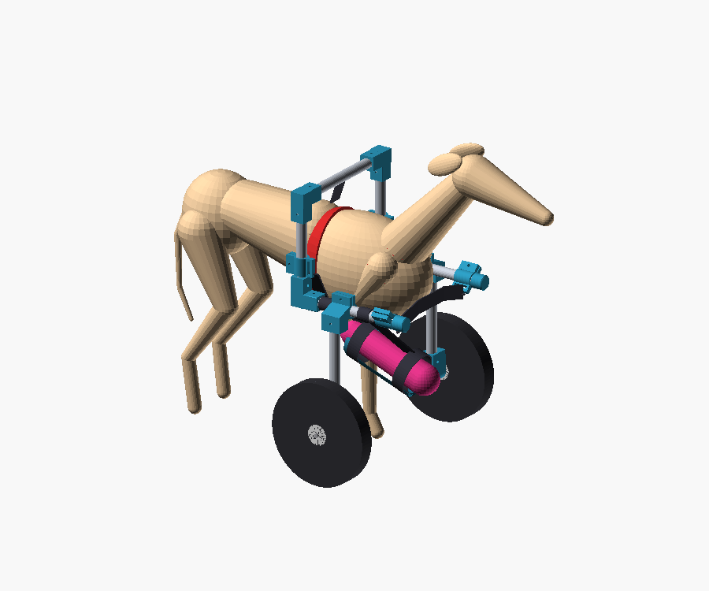

# Bianka po operacji: wózek i nosidło

Bianka (whippet, 9 miesięcy, ok. 13 kg) ma po operacji sztywny opatrunek
na prawej przedniej łapie i nie może na niej stawać. Są tu dwa
rozwiązania:

| [V1: wózek na przednie koła](v1-wozek/) | [V2: nosidło-przytulak](v2-nosidlo/) |
|---|---|
|  |  |
| Bianka chodzi lewą przednią i tylnymi łapami. Przód niosą dwa koła przez temblak pod mostkiem, a łapa w opatrunku leży w kołysce. Rama z rur aluminiowych Ø20 mm i drukowanych złączek z PETG (OpenSCAD, druk bez podpór). | Siedzisko biodrowe z atestem do 20 kg i przeróbki dla psa: poduszka z wałkiem, linka asekuracyjna do szelek, podpórka na opatrunek. Bianka siedzi przodem do Ciebie, oparta o Twoją klatkę. Godzina noszenia bez bólu pleców. |

## Zanim użyjesz któregokolwiek: zapytaj weterynarza

1. Czy Bianka może spacerować na smyczy w wózku, który niesie przód, a
   chorą łapę trzyma zgiętą w kołysce? Ile minut dziennie?
2. Czy może godzinę siedzieć w nosidle z łapą w opatrunku podpartą na
   wysokości barku?
3. Jak długo opatrunek zostaje i kiedy będzie zmieniany? Po zmianie trzeba
   zmierzyć go od nowa i wydrukować kołyskę pod nowy wymiar.

Oba projekty powstały bez przymiarki na Biance. Wymiary trzeba zmierzyć,
a pierwsze użycie zrobić w domu, krótko i ze smakołykami.
