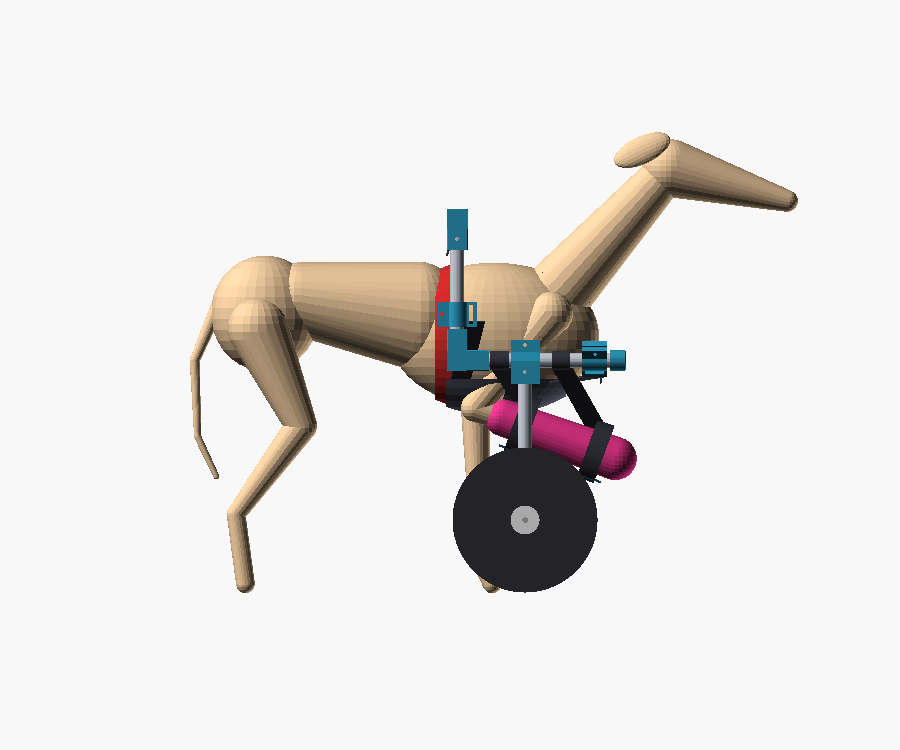
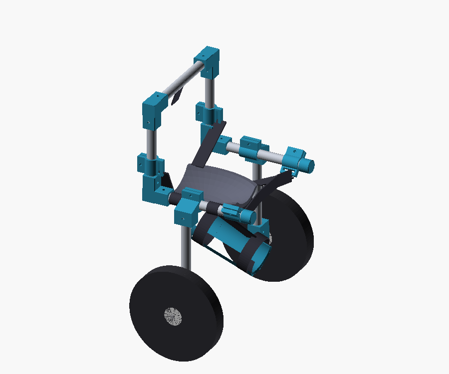
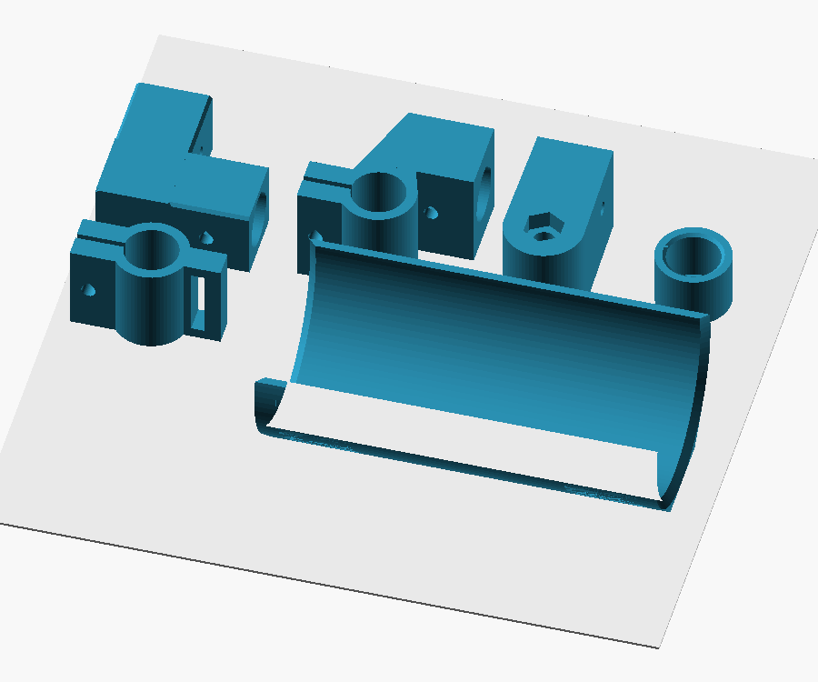

# V1: wózek na przednie koła dla Bianki

Bianka chodzi „normalnie”, a prawa przednia łapa w opatrunku cały czas
wisi w powietrzu. Dwa koła po bokach przednich łap przejmują ciężar przodu
psa przez miękki temblak pod mostkiem. Łapa w opatrunku leży w wyściełanej
kołysce podwieszonej pod prawą rurą ramy. Lewa przednia łapa i obie tylne
chodzą swobodnie, więc rytm kroku i skręcanie zostają naturalne.

> **Najpierw zgoda weterynarza.** Wózek nie zastępuje zaleceń po operacji.
> Zapytaj lekarza prowadzącego: czy Bianka może spacerować na smyczy w
> wózku, ile minut dziennie i czy łapę można trzymać zgiętą w kołysce. Jeśli
> zalecenie to „tylko klatka i wyjście na siku”, wózek poczeka.

| Złożenie (prawy bok, przód) | Widok z boku |
|---|---|
|  |  |

| Rama z temblakiem i kołyską | Części w orientacji do druku |
|---|---|
|  |  |

Sylwetka psa na renderach jest tylko poglądowa.

## Dlaczego tak

- **Koła obok łap, a nie przed psem.** Oś kół leży pod środkiem temblaka,
  więc rama jest wyważona: nie naciska na kark ani na grzbiet. Pozycję osi
  ustawiasz, przesuwając zaciski T po rurach bocznych. Nie trzeba niczego
  wiercić od nowa.
- **Pałąk nad grzbietem zamiast poprzeczki przed piersią.** Głowa i szyja
  są wolne. Bianka może węszyć i podjąć smakołyk z ziemi, a pod gardłem nic
  jej nie uwiera.
- **Kołyska zamiast pętli z taśmy.** Opatrunek leży w niej na całej
  długości. Brzeg kołyski kończy się na opatrunku, a nie na gołej skórze
  powyżej. Po zmianie opatrunku drukujesz nową kołyskę pod nową średnicę
  (ok. 2 h druku).
- **Lewa przednia łapa jest wolna.** Wózek niesie ciężar, a Bianka używa
  lewej łapy do równowagi i skręcania. To bliższe normalnemu chodowi niż
  skakanie na trzech łapach, przy którym chora łapa podskakuje przy każdym
  kroku.
- **Śruby w płaszczyźnie kolanek.** Żaden łeb śruby ani nakrętka nie
  celuje w żebra psa.
- **Lekko i bez spawania.** Rama z rur aluminiowych 20 × 1,5 mm i
  złączek z PETG waży ok. 1,3–1,7 kg razem z kołami. Z grubsza licząc, rura
  boczna przy trzykrotnym przeciążeniu (podskok, nierówność) pracuje z
  naprężeniem ok. 50 MPa, a aluminium 6060 wytrzymuje ok. 150 MPa.
- **Siku w wózku.** Wózek podpiera tylko przód, a tył jest wolny. Rama
  może się pochylić wokół osi kół, więc suczka powinna dać radę
  przykucnąć. Położyć się w wózku nie może.

## Pomiary (zrób je przed drukiem)

Bianka stoi równo na wszystkich łapach, na płaskiej podłodze. Na czas
pomiaru możesz podeprzeć łapę w opatrunku dłonią.

| Parametr | Domyślnie | Jak zmierzyć |
|---|---|---|
| `h_withers` | 460 | wysokość w kłębie: połóż książkę na najwyższym punkcie łopatek i zmierz do podłogi |
| `h_sternum` | 250 | od podłogi do najniższego punktu klatki tuż za łokciami |
| `w_chest` | 160 | najszersze miejsce klatki za łokciami: przyłóż z boków dwie książki i zmierz odstęp |
| `l_chest` | 170 | poziomo od przedpiersia (przód klatki między łapami) do miejsca, gdzie leży pas szelek za łokciami |
| `cast_d` | 60 | największa średnica opatrunku: suwmiarką albo obwód taśmą podzielony przez 3,14 |
| `cast_len` | 150 | długość prostego odcinka opatrunku, który ma leżeć w kołysce |

Wartości domyślne to szacunek dla whippeta suczki ok. 13 kg. **Wpisz
pomiary Bianki** i wygeneruj długości rur (niżej).

## Zakupy

| Co | Ile | Uwagi |
|---|---|---|
| Rura aluminiowa okrągła **20 × 1,5 mm** (lub 20 × 2) | 2 × 1 m | markety budowlane; 20 × 1 mm jest za cienka |
| Koło **200 mm z łożyskami 608** (hulajnogowe, PU) | 2 | na trawę lepsze pompowane 8″, ale sprawdź, czy mają łożyska 608 (otwór 8 mm) |
| Śruba M8 × 80 + nakrętka samokontrująca M8 + 4 podkładki M8 | 2 kpl. | oś koła |
| Śruba M5 × 40 | 12 | kolanka, golenie |
| Śruba M5 × 30 | 6 | zaciski T i obejmy |
| Nakrętka samokontrująca M5 + 2 podkładki M5 | 18 kpl. | |
| Taśma nośna 25 mm (nylon lub PP) | ok. 3 m | temblak, pas piersiowy, łącznik z szelkami |
| Klamra zatrzaskowa 25 mm + regulator (suwak) 25 mm | 6 + 6 | żeby wszystko dało się dopiąć i wyregulować |
| Opaska na rzep 25 mm, ok. 40 cm | 4 | dwie na kołyskę, dwie do zawieszenia jej pod rurą |
| Pianka 5–6 mm (np. stara karimata) + polar | ok. 40 × 50 cm | wyściółka kołyski i temblaka |

Narzędzia: piłka do metalu, pilnik, wiertarka z wiertłem 5,5 mm, klucze 8
i 13 mm, imbus do śrub.

## Części do druku (`stl/`)

| Plik | Sztuk | Na co |
|---|---|---|
| `kolanko_90_x4.stl` | 4 | narożniki pałąka nad grzbietem |
| `zacisk_T_x2.stl` | 2 | przesuwny zacisk na rurze bocznej z gniazdem goleni koła |
| `piasta_osi_x2.stl` | 2 | dół goleni, oś koła M8 z gniazdem nakrętki |
| `obejma_tasmy_x4.stl` | 4 | przesuwne ucha na taśmy temblaka i pasa piersiowego (szczelina mieści 2 taśmy) |
| `zaslepka_x2.stl` | 2 | zakrywa ostry koniec rury bocznej z przodu |
| `kolyska_opatrunku_d60_x1.stl` | 1 | kołyska na opatrunek Ø60 mm (**wygeneruj pod swój pomiar**) |

Wszystkie części jednego typu są symetryczne, więc te same pliki pasują po
lewej i po prawej stronie.

### Druk (Bambu Lab P2S lub podobna)

- **Podpory: WYŁĄCZONE.** Orientacja jak w plikach STL, nie obracaj.
- **PETG**, warstwa 0,2 mm, **5 ścian**, 5 warstw góra i dół, wypełnienie
  **40% gyroid**. To części nośne: nie oszczędzaj na ścianach.
- Razem ok. 0,5 kg filamentu (wystarczy jedna szpula). Wszystkie części
  mieszczą się na jednym stole 256 × 256 mm po 1 sztuce. Komplet to 2–3
  stoły.
- Poziome gniazda na rury mają kształt „kropli” ze ściętym czubkiem. Nad
  rurą zostaje mostek ok. 6 mm, który drukarka robi bez podpór. Nie
  przeszkadza on w pasowaniu.
- Skrypt sprawdzający nawisy (ścianki skierowane w dół, bardziej płaskie
  niż 45°, nieleżące na stole) znajduje tylko mostki: 6 mm nad gniazdami
  rur, 5 mm nad szczeliną obejmy i stopień 1,5 mm na końcu rowków kołyski.
- Najpierw wydrukuj jedną obejmę i sprawdź, jak wchodzi na Twoją rurę.
  Powinna przesuwać się z lekkim oporem. Jeśli idzie za ciasno, zwiększ
  `fit` o 0,1–0,2 mm.

## Długości rur

Program wylicza je z pomiarów i wypisuje w konsoli OpenSCAD (`ECHO`). Dla
wartości domyślnych:

| Rura | Sztuk | Długość |
|---|---|---|
| boczna | 2 | 219 mm |
| pionowa (pałąk) | 2 | 173 mm |
| poprzeczka nad grzbietem | 1 | 228 mm |
| goleń koła | 2 | 208 mm |

Razem 1426 mm. Z dwóch rur po 1 m: pierwsza = 2 × boczna + poprzeczka +
goleń, druga = 2 × pionowa + goleń. Rozstaw kół wynosi ok. 39 cm (całość
ok. 42 cm, przejdzie przez każde drzwi).

Własne wartości:

```sh
openscad -o rury.echo -D h_withers=470 -D h_sternum=255 -D w_chest=165 -D l_chest=175 wozek_przednie_kola.scad
cat rury.echo
# kołyska pod opatrunek o średnicy 64 mm i długości 140 mm
openscad -o kolyska.stl -D 'part="cast_cradle"' -D cast_d=64 -D cast_len=140 wozek_przednie_kola.scad
```

Albo otwórz plik w OpenSCAD, zmień wartości w panelu Customizer (Okno →
Customizer) i naciśnij F5. Złożenie od razu pokaże, czy rama mieści psa.

## Montaż

1. **Przytnij rury** i usuń zadziory pilnikiem, wewnątrz i na zewnątrz.
2. **Najpierw nasuń części przesuwne**, bo potem nie wejdą:
   - na każdą rurę boczną: zacisk T (gniazdem goleni w dół i na zewnątrz)
     i jedną obejmę bliżej przedniego końca (uchem w dół, do środka),
   - na każdą rurę pionową: jedną obejmę.
3. **Złóż pałąk:** poprzeczka, 2 górne kolanka, 2 rury pionowe, 2 dolne
   kolanka, a do nich rury boczne. Na przednie końce rur bocznych wciśnij
   zaślepki (kropla kleju CA).
4. **Ustaw ramę płasko na stole i przewierć rury** wiertłem 5,5 mm,
   prowadząc je przez otwory w kolankach. Kolanko jest szablonem. Skręć
   śrubami M5 × 40 z podkładkami.
5. **Golenie:** wsuń w zaciski T i w piasty osi (gniazdem nakrętki do
   środka, w stronę psa). Przewierć przez otwory i skręć. Zaciski T zostaw
   na razie luźno, bo ich pozycję ustawisz na psie.
6. **Koła:** śruba M8 od zewnątrz → podkładka → koło → 2 podkładki →
   piasta → nakrętka w sześciokątnym gnieździe. Dokręć tak, żeby koło
   kręciło się lekko i bez luzu na boki.
7. **Kołyska:** wyłóż ją pianką i polarem (taśma dwustronna albo klej),
   włóż dwa rzepy w rowki na zewnątrz kołyski.

### Temblak pod mostek

Najprostszy jest pas wyściełany szerokości ok. 12 cm i długości ok. 20 cm
(polar + pianka 5 mm + mocna tkanina od spodu, np. cordura). Pas biegnie pod
mostkiem od linii szelek za łokciami do przodu, aż między przednie łapy, i
z przodu zwęża się do ok. 6 cm. Do każdego z czterech rogów przyszyj taśmę
25 mm z klamrą i regulatorem:

- tylne rogi → obejmy na rurach pionowych,
- przednie rogi → obejmy z przodu rur bocznych.

Jeśli wolisz nie szyć, kup gotowe szelki rehabilitacyjne z wyściełanym
panelem pod klatką (przednie szelki podtrzymujące) i przypnij ich boczne
uchwyty do obejm.

Dodatkowo potrzebne są:
- **pas piersiowy:** taśma od lewej przedniej obejmy, przed klatką, na
  wysokości stawów barkowych (nigdy na gardle!), do prawej przedniej
  obejmy,
- **łącznik:** krótka taśma z poprzeczki nad grzbietem do kółka na
  grzbiecie szelek. Blokuje przesuwanie się ramy wzdłuż psa.

## Dopasowanie na Biance

1. Bianka ma na sobie swoje zwykłe szelki (typu Y/H z kółkiem na grzbiecie).
2. Wprowadź ją do wózka od tyłu albo nasuń wózek od przodu, tak żeby pałąk
   przeszedł nad głową i szyją. Pałąk ma leżeć tuż za łopatkami, nad pasem
   szelek.
3. Zapnij temblak i ureguluj taśmy. Klatka ma spoczywać w temblaku, grzbiet
   ma być poziomo, a lewa przednia łapa ma dotykać ziemi z lekkim
   obciążeniem. Bianka nie może wisieć z łapami w powietrzu.
4. **Łapa w kołysce:** opatrunek leży na całej długości kołyski, a jej
   tylny brzeg kończy się na opatrunku. Zapnij oba rzepy wokół kołyski.
   Kołyskę zawieś na dwóch opaskach owiniętych wokół prawej rury bocznej:
   jedna przed zaciskiem T, druga za nim. Ustaw długość tak, żeby łapa była
   zgięta swobodnie, bez wymuszania, a koniec opatrunku był co najmniej
   5–8 cm nad ziemią.
5. Zapnij pas piersiowy i łącznik z szelkami.
6. **Wyważenie:** odepnij na chwilę łącznik z szelkami.
   - Jeśli pałąk opada na grzbiet, przesuń oba zaciski T do tyłu.
   - Jeśli przód ramy opada, przesuń je do przodu.
   Kiedy rama trzyma się prosto, dokręć zaciski i przypnij łącznik z
   powrotem.
7. Sprawdź prześwity: między rurami bocznymi a łokciami ma być co najmniej
   2 palce, a między poprzeczką a grzbietem co najmniej 3 palce. Golenie
   nie mogą dotykać lewej łapy w żadnej fazie kroku.

## Oswajanie i spacery

- **Dzień 1:** wózek stoi w pokoju, smakołyki przy nim i na nim. Potem 1–2
  minuty w wózku na stojąco, na podłodze, która się nie ślizga.
- Kolejne sesje po 2–5 minut, 2–3 razy dziennie. Prowadź smakołykiem
  trzymanym przed nosem, na wysokości nosa. Wydłużaj czas stopniowo, ale
  tylko do limitu od weterynarza.
- Bianka skręca, przestawiając zad. Pierwsze zakręty prowadź szerokim
  łukiem.
- **Zawsze na smyczy i w Twoim tempie.** Tylko płaski teren. Bez schodów,
  krawężników, stromych zboczy, biegania i zabawy z innymi psami. Whippet
  w wózku nadal jest whippetem.
- Nigdy nie zostawiaj jej w wózku samej. Kiedy chce się położyć, zdejmij
  wózek.

**Po każdym spacerze sprawdź:** pachy, mostek, kłąb i miejsca pod taśmami
(czy nie ma zaczerwienienia lub wytartej sierści). Sprawdź też opatrunek:
górna krawędź nie może obcierać, palce (jeśli je widać) nie mogą być
spuchnięte ani zimne, a opatrunek ma być suchy. Na mokrą trawę zakładaj na
opatrunek ochraniacz albo worek.

**Przerwij i skonsultuj się z lekarzem, jeśli:** Bianka panikuje, liże albo
gryzie opatrunek, łapa puchnie, próbuje opierać się opatrunkiem o kołyskę
albo ziemię, zaczyna kuleć na inną łapę albo pojawiają się otarcia.

## Parametry (OpenSCAD → Okno → Customizer)

| Parametr | Domyślnie | Opis |
|---|---|---|
| `part` | `assembly` | `assembly`, `frame` (bez psa), pojedyncze części, `plate` |
| `h_withers`, `h_sternum`, `w_chest`, `l_chest` | 460, 250, 160, 170 | pomiary psa (wyżej) |
| `cast_d`, `cast_len`, `pad_t` | 60, 150, 6 | opatrunek i grubość wyściółki kołyski |
| `wheel_d`, `wheel_w` | 200, 30 | koła |
| `side_clr` | 35 | luz między klatką a rurą boczną |
| `top_clr` | 45 | luz między kłębem a poprzeczką |
| `bar_above_sternum` | 70 | wysokość rur bocznych nad mostkiem |
| `nose` | 60 | ile rury boczne wystają przed klatkę |
| `axle_x` | -1 (auto) | oś kół przed linią popręgu; auto = 0,55 × `l_chest` |
| `strut_off` | 28 | odsunięcie goleni na zewnątrz rury bocznej |
| `fit` | 0,4 | luz średnicy gniazd na rurę |
| `tube_d` | 20 | średnica rury |

## Ograniczenia

- Projekt powstał bez Bianki i bez wózka w ręku. Domyślne wymiary to
  szacunek, dlatego pomiary są obowiązkowe. Pierwsze dopasowanie zwykle
  wymaga regulacji taśm.
- To nie jest wyrób medyczny. O tym, czy i jak długo Bianka może chodzić,
  decyduje lekarz prowadzący. Jeśli wolisz gotowe rozwiązanie, poszukaj
  hasła „wózek dla psa na przednie łapy” (dwukołowy wózek przedni z
  podparciem pod klatką). Taki wózek robi się na wymiar.
