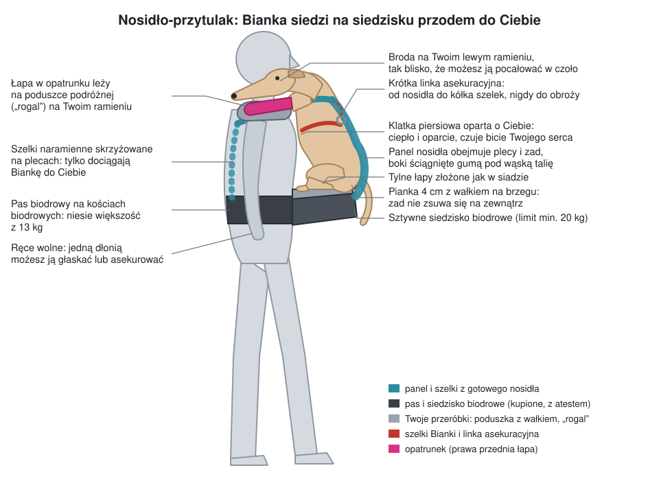

# V2: nosidło-przytulak dla Bianki

Bianka siedzi na sztywnym siedzisku zapiętym na Twoich biodrach, przodem
do Ciebie. Klatką piersiową opiera się o Twoją klatkę, a brodę kładzie na
Twoim ramieniu. Panel nosidła obejmuje jej plecy i zad. Łapa w opatrunku
leży na poduszce na Twoim lewym ramieniu.

## Dlaczego tak

**Dla Ciebie.** To ten sam układ, w którym rodzice godzinami noszą
13-kilogramowe dzieci w nosidłach z siedziskiem biodrowym. Większość
ciężaru idzie przez szeroki pas na kości biodrowe, a szelki tylko
dociągają psa do Ciebie. Środek ciężkości jest tuż przy Twoim ciele, więc
plecy nie muszą go „łapać”. Ręce zostają wolne.

**Dla Bianki.**
- Jej ciężar rozkłada się na zad (na miękkim siedzisku) i na klatkę
  piersiową (opartą o Ciebie). Nie wisi na pachach ani na brzuchu.
- Whippet nie ma tłuszczu i szybko marznie, a przy Tobie jest jej ciepło.
  Słyszy Twoje serce i czuje zapach, co uspokaja po zabiegu i wizytach u
  weterynarza. Może zasnąć z głową na Twoim ramieniu.
- Łapa w opatrunku jest cały czas podparta i masz ją przed oczami.

**Czego unikać:**
- **Plecaków dla psów z łapami na zewnątrz.** Przednie łapy (także ta w
  opatrunku) zwisają przez godzinę, a ciężar ciśnie na pachy.
- **Torby na jedno ramię.** 13 kg na jednym barku przez godzinę to za dużo.
- **Noszenia na rękach.** Wytrzymasz kilka minut, a nie godzinę.

**Dlaczego część nośna jest kupiona, a nie wydrukowana lub uszyta:** pas,
klamry i szwy niosą 13 kg psa ze świeżą operacją na wysokości ok. 1 m.
Pęknięta klamra albo puszczony szew oznacza upadek. Dlatego bazą jest
nosidło dziecięce z deklarowanym limitem wagi, a Twoje przeróbki dotyczą
tylko wygody i dopasowania do psa. W tej wersji nic nie trzeba drukować.

## Co kupić

**Nosidło biodrowe 2 w 1** (tzw. hipseat: pas z siedziskiem + panel z
szelkami). Samo siedzisko bez panelu i szelek nie wystarczy.

| Cecha | Wymaganie |
|---|---|
| Limit wagi | **co najmniej 20 kg** (taki limit ma wiele modeli; sprawdź w instrukcji konkretnego) |
| Pas biodrowy | wysoki (ok. 15 cm), wyściełany, z usztywnieniem w lędźwiach; rzep i klamra jako podwójne zapięcie |
| Siedzisko | twarde, głębokie na co najmniej ok. 15 cm |
| Panel | wysokość od siedziska co najmniej ok. 40 cm, czyli do łopatek Bianki; regulowana szerokość |
| Szelki | wyściełane, krzyżowane na plecach albo z paskiem piersiowym |

Może być używane. Sprawdź klamry (bez pęknięć), szwy przy pasie i
szelkach oraz plastikowy korpus siedziska.

## Przeróbki (bez maszyny do szycia)

1. **Poduszka na siedzisko z wałkiem.** Pianka termoelastyczna 4 cm wycięta
   w kształt siedziska i 3–4 cm dłuższa od jego zewnętrznego brzegu. Na
   zewnętrznym brzegu zwinięty ręcznik albo wałek z pianki o średnicy ok.
   5 cm, żeby zad nie zsuwał się na zewnątrz. Całość w polarowym
   pokrowcu, pod spodem mata antypoślizgowa. Mocowanie: rzep albo gumka
   pod siedziskiem. Whippet ma kościsty zad, więc ta poduszka robi
   największą różnicę w komforcie.
2. **Linka asekuracyjna.** Taśma 25–30 cm z karabińczykiem z blokadą
   (zakręcaną), przywiązana do górnej krawędzi panelu od środka albo do
   klamry szelki naramiennej. Wpinasz ją w kółko na grzbiecie szelek
   Bianki, **nigdy w obrożę**. Ma być na tyle krótka, żeby Bianka mogła się
   poprawić, ale nie mogła wyskoczyć.
3. **Podpórka na łapę w opatrunku.** Poduszka podróżna typu „rogal” na
   Twojej szyi. Bianka kładzie na niej łapę w opatrunku (na Twoim lewym
   ramieniu) i często też brodę. Alternatywa: wyściełany rękaw z polaru
   przypięty rzepem do lewej szelki.
4. **Zwężenie panelu.** Nosidło jest szyte na dziecko, a Bianka ma wąską
   talię. Przewlecz przez boki panelu linkę elastyczną 4–5 mm ze stoperami
   albo owiń panel dwoma paskami na rzep, żeby obejmował ją ciasno i się
   nie przekręcała.
5. **Polar.** Wyściółka między Bianką a panelem (łatwiej wyprać) i koc na
   chłodne dni. W październiku whippet bez okrycia szybko marznie, więc
   sprawdzaj uszy i łapy.

## Pierwsza przymiarka: bez psa

Włóż do nosidła 13 kg (np. butelki z wodą w plecaku postawionym na
siedzisku) i ustaw pas oraz szelki. Pochodź 15 minut po domu. Dopiero
wtedy przymierzaj z Bianką.

## Zakładanie krok po kroku

1. Bianka ma założone szelki. Posadź ją na kanapie, podnosząc jedną ręką
   pod klatkę tuż za przednimi łapami i drugą pod zad. **Nigdy za łapy.**
2. Zapnij pas biodrowy **na kościach biodrowych** (nie w talii), siedzisko
   pośrodku z przodu. Dociągnij mocno.
3. Usiądź na brzegu kanapy obok Bianki i wepnij linkę asekuracyjną w jej
   szelki.
4. Przenieś Biankę na siedzisko: zad na poduszce, przodem do Ciebie,
   klatka przy Twojej klatce. Pozwól jej złożyć tylne łapy jak w siadzie.
5. Połóż łapę w opatrunku na „rogalu” na Twoim lewym ramieniu. Lewą
   przednią łapę Bianka układa, jak jej wygodnie (przez prawe ramię albo w
   dół).
6. Podciągnij panel po jej plecach do łopatek. Załóż szelki po kolei,
   jedną ręką cały czas trzymając Biankę. Zapnij je i dociągnij, a potem
   ściągnij boki panelu.
7. Sprawdź:
   - Bianka siedzi na zadzie i nie wisi w panelu,
   - opatrunek jest podparty i nic go nie przyciska,
   - nic nie uciska jej gardła,
   - jest tak wysoko, że możesz pocałować ją w czoło.
8. Wstań siłą nóg, z prostymi plecami.

**Zdejmowanie** odbywa się w odwrotnej kolejności i zawsze na siedząco.
Linkę asekuracyjną odpinasz na samym końcu, gdy Bianka siedzi już na
kanapie.

## Godzina noszenia: żeby obojgu było dobrze

- **Pas mocno na biodrach.** Jeśli bolą Cię barki, pas jest za luźny albo
  za nisko.
- **Szelki dociągnięte.** Nawet 5 cm przerwy między Wami szybko daje ból
  krzyża. Idź wyprostowany, nie odchylaj się do tyłu. Schylaj się tylko z
  przysiadu.
- **Przerwa co 20–30 minut:** usiądź, poluzuj na chwilę szelki i pozwól
  Biance zmienić pozycję. Sprawdź opatrunek i palce.
- **Stopniuj:** w domu 15 minut, potem 30, dopiero potem godzina na dworze.
- **Przed wyjściem** daj jej się załatwić (jeśli weterynarz pozwala na
  krótkie wyjście na trzech łapach).

## Bezpieczeństwo Bianki

- Opatrunek nigdy nie może być ściśnięty między Wami. Ma leżeć na
  podpórce. Jeśli widać palce, sprawdzaj, czy nie puchną i nie są zimne.
  Na deszcz załóż na opatrunek worek albo ochraniacz.
- Szybkie dyszenie i niepokój mogą oznaczać przegrzanie (jest przytulona
  do Ciebie) albo ból. Zrób przerwę w chłodnym miejscu.
- Whippet na widok kota albo wiewiórki wystrzeliwuje bez ostrzeżenia. Gdy
  coś takiego jest w pobliżu, trzymaj na niej dłoń. Linka jest tylko
  zabezpieczeniem.
- Zapytaj lekarza prowadzącego, czy godzina w pozycji siedzącej jest dla
  niej w porządku. Przy urazie przedniej łapy zwykle tak, ale szczegóły
  operacji zna lekarz.

## Alternatywy

- **Na plecach:** dziecięce nosidło turystyczne ze stelażem (limit ok.
  20–22 kg). To najlepsze rozwiązanie dla Twoich pleców na długie wyjścia,
  ale nie widzisz Bianki, ona siedzi prosto (charty nie lubią długo
  siedzieć), a wkładanie wymaga podpórki nosidła i najlepiej drugiej
  osoby. Przymierz je z Bianką przed zakupem.
- **Na leżąco:** jeśli godzina to spacer po płaskim, najwygodniej dla obojga
  będzie w gondoli wózka dziecięcego (choćby używanego) albo w wózku dla
  psów 15–20 kg. Bianka leży zwinięta w kłębek jak na kanapie, opatrunek
  leży swobodnie, a Ty nic nie dźwigasz. W środku też przypnij linkę
  asekuracyjną.

## Ograniczenia

To projekt na papierze. Konkretne nosidła różnią się wymiarami siedziska i
panelu, a Bianka ma swoje zdanie. Pierwsza przymiarka pokaże, co jeszcze
trzeba dopasować (zwykle wysokość panelu i ściągnięcie boków).
