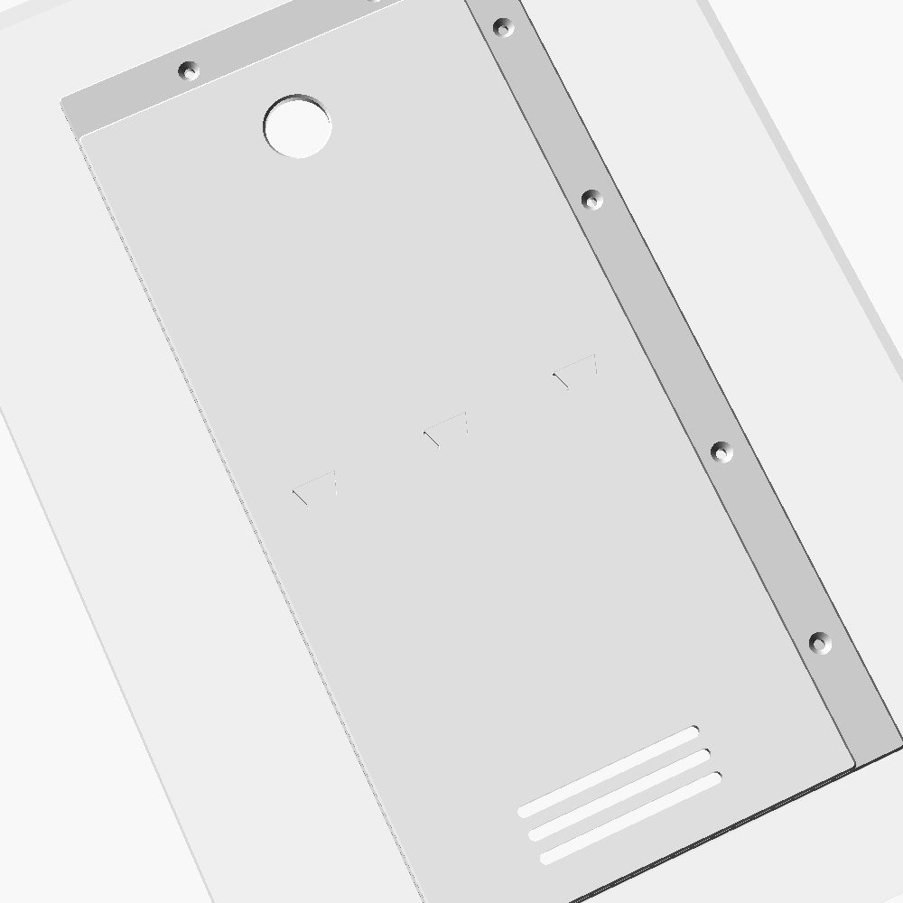
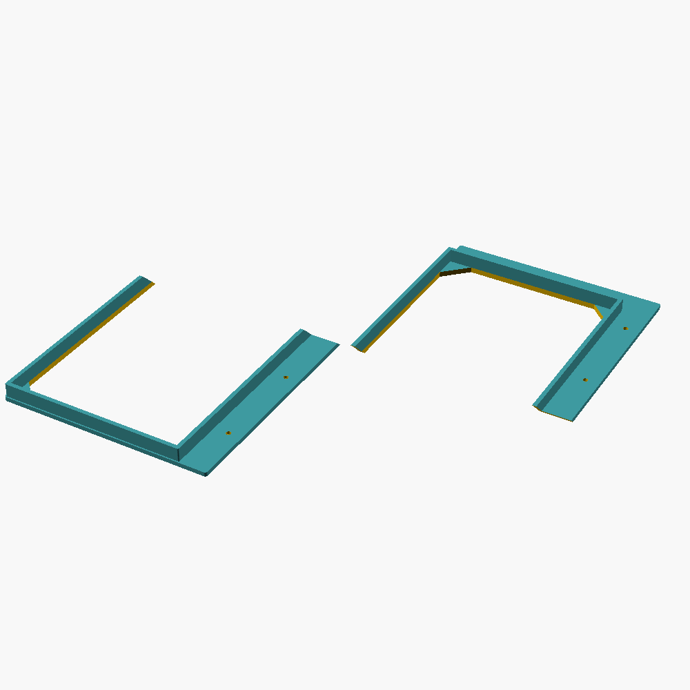
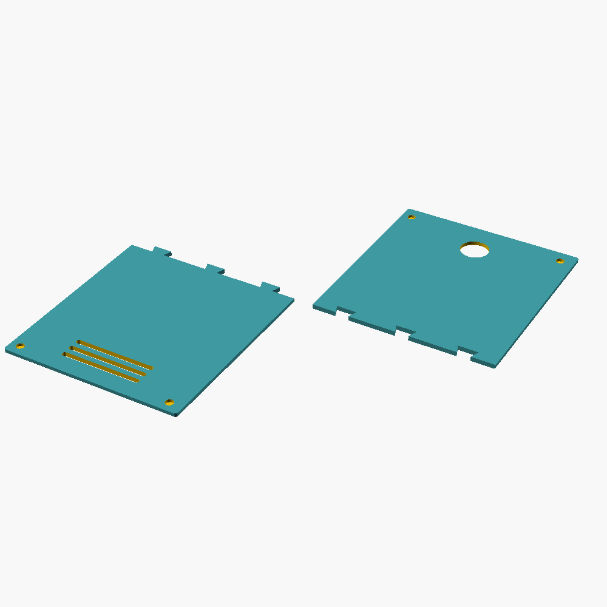
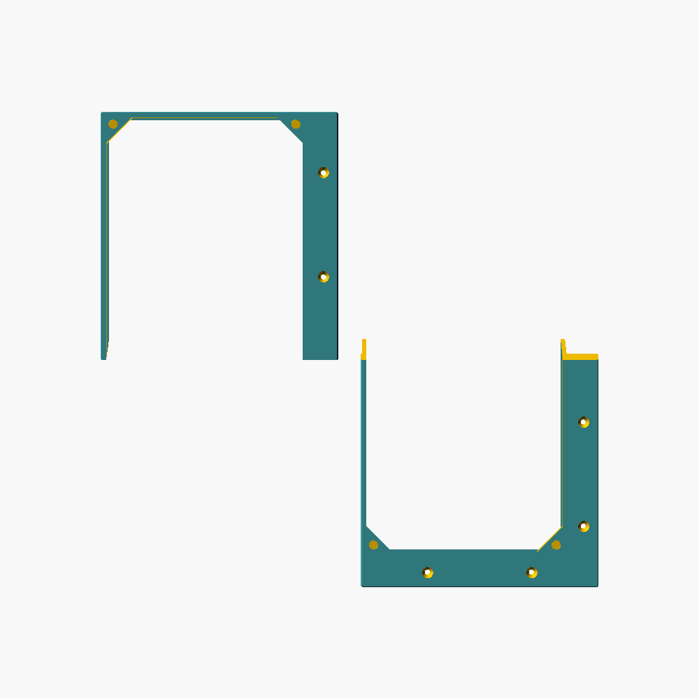

# Drzwiczki rewizyjne do otworu w szafce łazienkowej (wodomierz)

Parametryczna ramka i zdejmowane drzwiczki na magnesy (OpenSCAD) do
prostokątnego otworu w ścianie za szafką. Ramka zakrywa poszarpane
krawędzie otworu, a drzwiczki zdejmujesz palcem, gdy chcesz odczytać
wodomierz albo zakręcić zawór.

| Złożenie na ścianie | Ramka (druk, przodem do stołu) | Drzwiczki (druk) |
|---|---|---|
|  |  |  |

Ramka od przodu: 

## Jak to działa

- **Ramka**: płyta 4 mm przyklejana do ściany, a za nią kołnierz 3 mm,
  który wchodzi ok. 10 mm w otwór i centruje ramkę. W narożnikach światła
  są trójkątne wsporniki z gniazdami na magnesy.
- **Drzwiczki**: płytka 3,5 mm nakładana na ramkę, z magnesami w
  narożnikach, otworem Ø22 mm na palec (do zdejmowania) i trzema
  szczelinami wentylacyjnymi na dole, żeby w zabudowie z rurami nie
  zbierała się wilgoć.
- **Zakładki osobno dla każdego boku.** Na zdjęciu lewa krawędź otworu
  jest tuż przy boku szafki, a dolna prawie na wysokości dna, więc
  domyślnie te dwie zakładki mają 0 mm (ramka nie wychodzi poza otwór).
  Prawa i górna mają po 20 mm i otwory na wkręty z łbem stożkowym.
- **Automatyczny podział.** Otwór ma ok. 30 cm wysokości, więc ramka i
  drzwiczki nie mieszczą się na stole 256 mm. Model sam dzieli je w
  poziomie: ramkę złączem ukośnym 45° (samo się centruje), a drzwiczki
  złączem na jaskółczy ogon. Kawałki sklejasz.
- **Druk bez podpór.** Obie części leżą przodem na stole (gładka strona
  PEI wychodzi na widok). Sprawdziłem STL-e skryptem szukającym nawisów
  poniżej 45°. Jedyny nawis to sufit gniazd magnesów w ramce: most Ø6 mm.

## ⚠️ Najpierw zmierz otwór

Wymiary domyślne (**140 × 300 mm**) oszacowałem ze zdjęcia, porównując je
z tarczą wodomierza, więc mogą być mocno niedokładne. Zmierz:

1. `hole_w`, `hole_h`: szerokość i wysokość otworu **w płaszczyźnie
   ściany**, w najwęższym miejscu.
2. `collar_d`: grubość płyty ściany przy otworze. Kołnierz nie może być
   głębszy, inaczej oprze się o rury. Jeśli otwór jest bardzo krzywy, daj
   `collar_d = 0`.
3. Ile miejsca masz wokół otworu na każdą zakładkę: do boku szafki, do
   dna i do półki. To są `flange_left/right/top/bottom`.

Po zmianie parametrów konsola OpenSCAD wypisze światło ramki, wymiary
części i liczbę kawałków.

## Pliki (`stl/`, wymiary domyślne, już ustawione do druku)

| Plik | Co |
|---|---|
| `ramka_kawalek_0.stl`, `ramka_kawalek_1.stl` | ramka 160 × 320 mm w 2 kawałkach |
| `drzwiczki_kawalek_0.stl`, `drzwiczki_kawalek_1.stl` | drzwiczki 141 × 301 mm w 2 kawałkach |

Światło (otwór dostępu) przy wymiarach domyślnych: 132 × 292 mm.

## Druk (np. Bambu Lab P2S)

- **Podpory: wyłączone.** Orientacja jak w plikach (przód na stole).
- **PETG** lub ASA (łazienka: ciepło i wilgoć). PLA też wytrzyma, bo w
  szafce nie ma dużych obciążeń.
- Warstwa 0,2 mm, 3 ściany, wypełnienie 15–20%. Biały filament zleje się
  ze ścianą.
- Pauza nie jest potrzebna: magnesy wklejasz po wydruku.

## Potrzebne elementy

- **8 magnesów neodymowych 6 × 2 mm** (4 w ramce, 4 w drzwiczkach). Możesz
  też dać magnesy tylko w ramce, a w drzwiczki wkleić stalowe krążki tej
  samej średnicy.
- Klej CA (do magnesów i do sklejenia kawałków) lub epoksyd.
- Do montażu: klej montażowy, silikon albo taśma dwustronna, a na
  zakładkach dodatkowo wkręty 3–3,5 mm z łbem stożkowym i kołkami.

## Montaż

1. Sklej kawałki ramki na złączu ukośnym, a drzwiczek na jaskółczy ogon.
   Dociśnij je na płaskim blacie.
2. Wklej magnesy w ramkę. **Zanim wkleisz magnesy w drzwiczki, sprawdź
   biegunowość**: przyłóż każdy magnes do magnesu w ramce i zaznacz
   markerem stronę, która ma patrzeć w stronę ramki.
3. Przymierz ramkę w otworze. Jeśli kołnierz trze o poszarpaną krawędź,
   zeszlifuj krawędź otworu albo zwiększ `hole_clr`.
4. Przyklej ramkę do ściany (cienko, żeby nie wyciskać kleju do światła),
   ewentualnie przykręć przez zakładki.
5. Przyłóż drzwiczki. Zdejmujesz je, ciągnąc palcem za otwór.

## Parametry (OpenSCAD → Okno → Customizer)

| Parametr | Domyślnie | Opis |
|---|---|---|
| `part` | `assembly` | `assembly` / `frame` / `door` |
| `piece` | -1 | kawałek do eksportu (0 = dolny); -1 = wszystkie obok siebie |
| `hole_w`, `hole_h` | 140, 300 | wymiary otworu (**zmierz**) |
| `collar_d` | 10 | głębokość kołnierza w otworze (0 = bez) |
| `hole_clr` | 1,0 | luz kołnierza w otworze na stronę |
| `flange_left/right/top/bottom` | 0 / 20 / 20 / 0 | zakładki ramki poza krawędź otworu |
| `plate_t`, `door_t` | 4, 3,5 | grubość ramki i drzwiczek |
| `door_ov` | 6 | ile drzwiczki zachodzą na ramkę (ograniczane automatycznie) |
| `finger_d`, `finger_off` | 22, 28 | otwór na palec i jego odległość od góry |
| `vents` | true | szczeliny wentylacyjne |
| `mag_d`, `mag_h` | 6, 2 | wymiar magnesów |
| `screws` | true | otwory na wkręty w zakładkach ≥ 12 mm |
| `bed` | 245 | maksymalny wymiar kawałka (od niego zależy podział) |

Eksport z linii poleceń:

```sh
for i in 0 1; do
  openscad -o ramka_$i.stl     -D 'part="frame"' -D piece=$i -D hole_w=150 -D hole_h=320 drzwiczki_rewizyjne.scad
  openscad -o drzwiczki_$i.stl -D 'part="door"'  -D piece=$i -D hole_w=150 -D hole_h=320 drzwiczki_rewizyjne.scad
done
```

Liczba kawałków zależy od wymiarów (podaje ją konsola). Jeśli otwór ma
mniej niż ok. 23 cm wysokości, każda część drukuje się w jednym kawałku.

## Ograniczenia

- Drzwiczki są nakładane i trzymane magnesami, bez zawiasu. To wystarczy,
  bo otwór i tak jest schowany za drzwiami szafki.
- Kołnierz zakłada, że otwór jest mniej więcej prostokątny. Przy bardzo
  nierównym otworze ustaw `collar_d = 0` i oprzyj ramkę na samej płycie
  (ustaw wtedy zakładki co najmniej na 5 mm).
