# Halloweenowe whippety – zestaw 6 mini figurek

Sześć siedzących whippetów w halloweenowych przebraniach, w stylu
zestawu „6 cute Halloween cats”. Mają ok. 31 mm wysokości (czarownica
z kapeluszem 41 mm) i drukują się **bez podpór**.

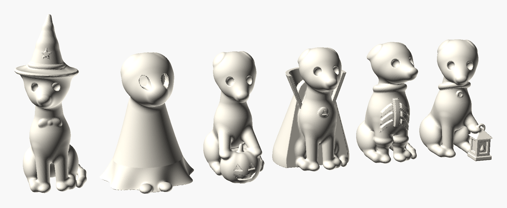

| # | Plik STL | Przebranie | Wymiary (mm) |
|---|---|---|---|
| 1 | [`1_whippet_czarownica.stl`](stl/1_whippet_czarownica.stl) | kapelusz czarownicy z gwiazdką, kokarda | 16 × 24 × 41 |
| 2 | [`2_whippet_duszek.stl`](stl/2_whippet_duszek.stl) | prześcieradło z dziurami na oczy; spod spodu łapki i ogon | 24 × 28 × 32 |
| 3 | [`3_whippet_z_dynia.stl`](stl/3_whippet_z_dynia.stl) | obejmuje łapami dynię z wyciętą buźką | 15 × 25 × 31 |
| 4 | [`4_whippet_wampir.stl`](stl/4_whippet_wampir.stl) | peleryna Draculi ze stojącym kołnierzem, medalion | 20 × 27 × 31 |
| 5 | [`5_whippet_sweter_szkielet.stl`](stl/5_whippet_sweter_szkielet.stl) | sweter z golfem i wypukłym szkieletem (mostek i żebra) | 15 × 24 × 31 |
| 6 | [`6_whippet_z_latarenka.stl`](stl/6_whippet_z_latarenka.stl) | szeroka chartowa obroża, łapa oparta na latarence | 15 × 24 × 31 |

| | | |
|---|---|---|
| 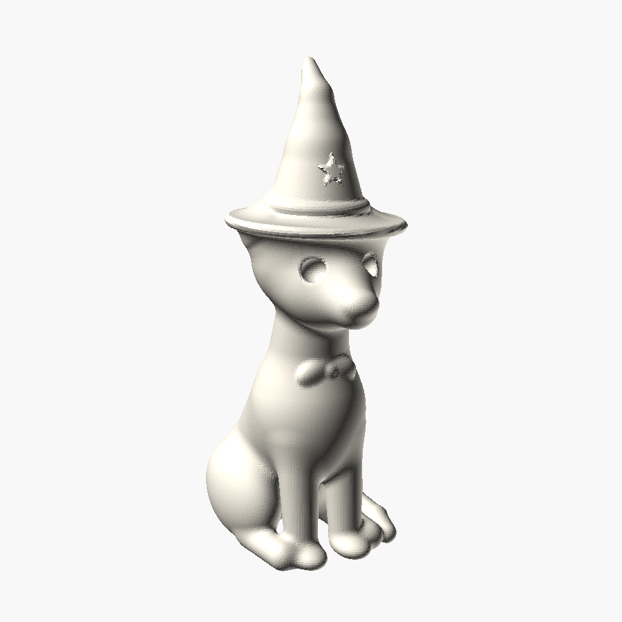 | 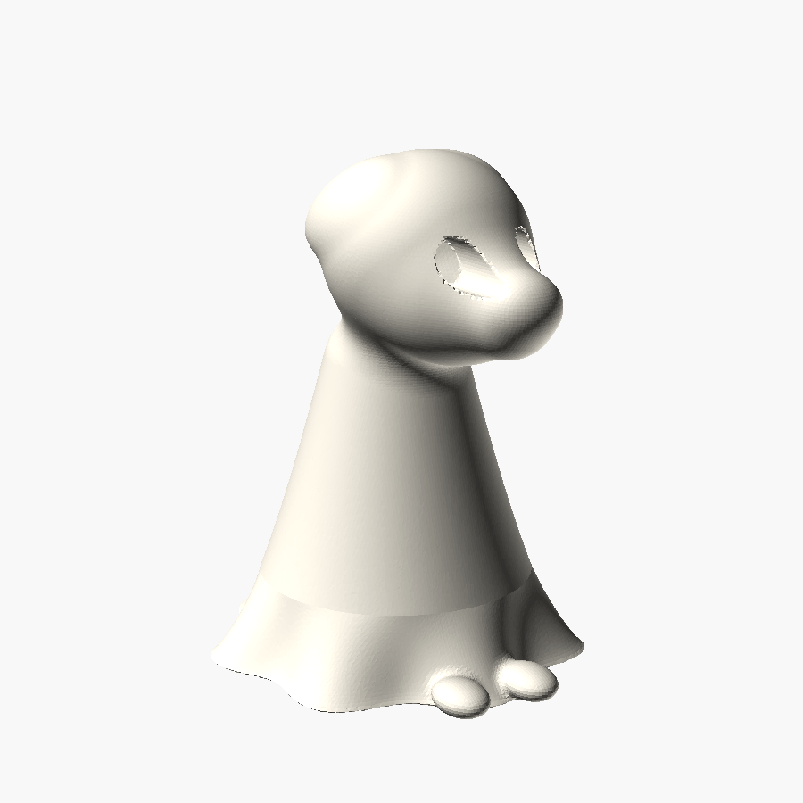 | 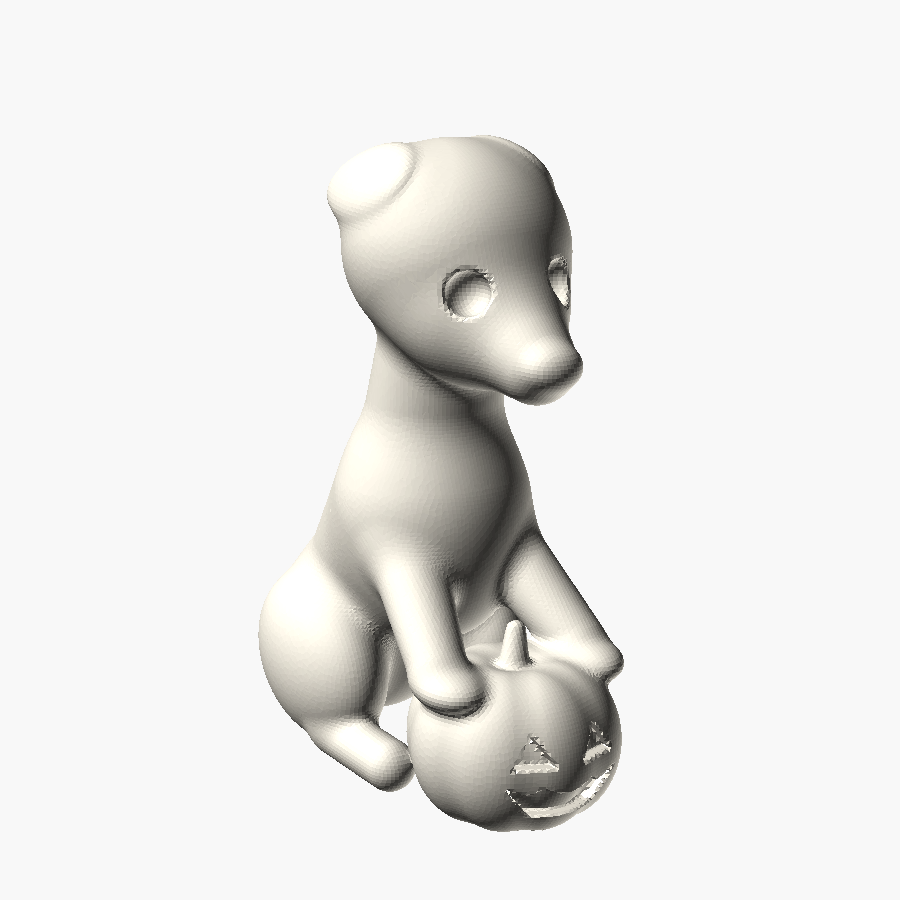 |
| 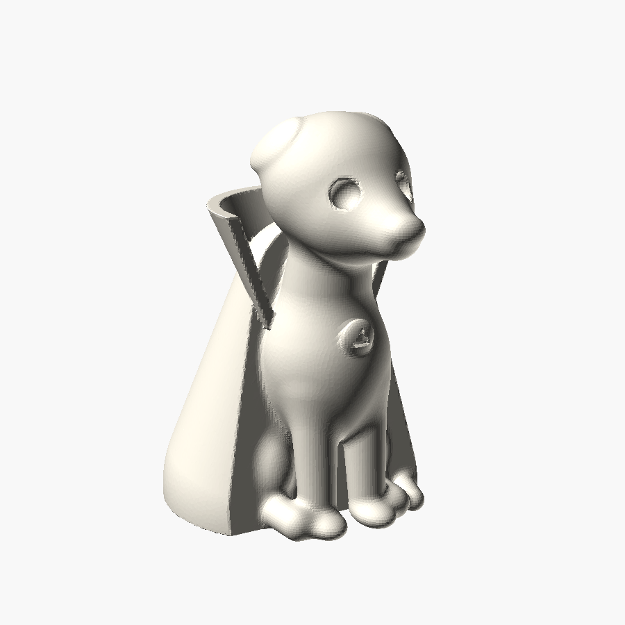 | 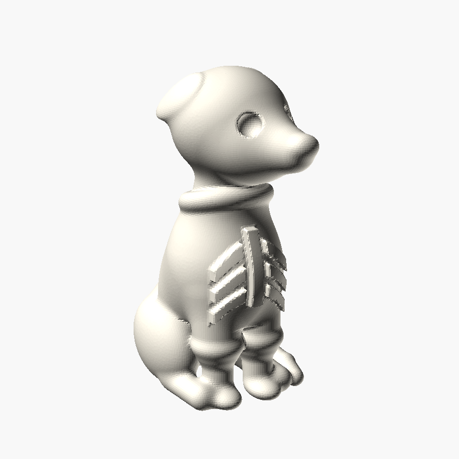 | 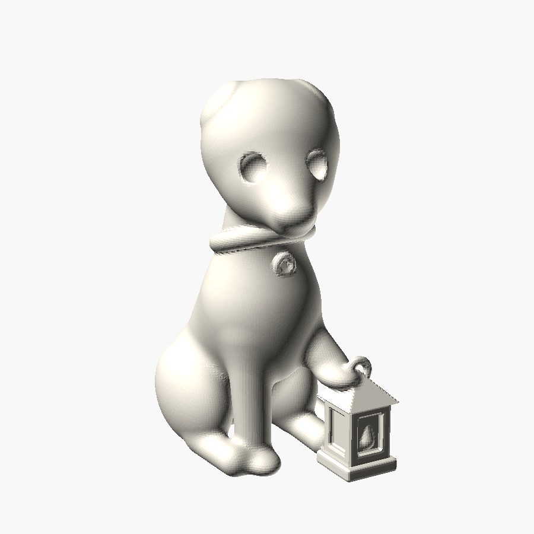 |
| 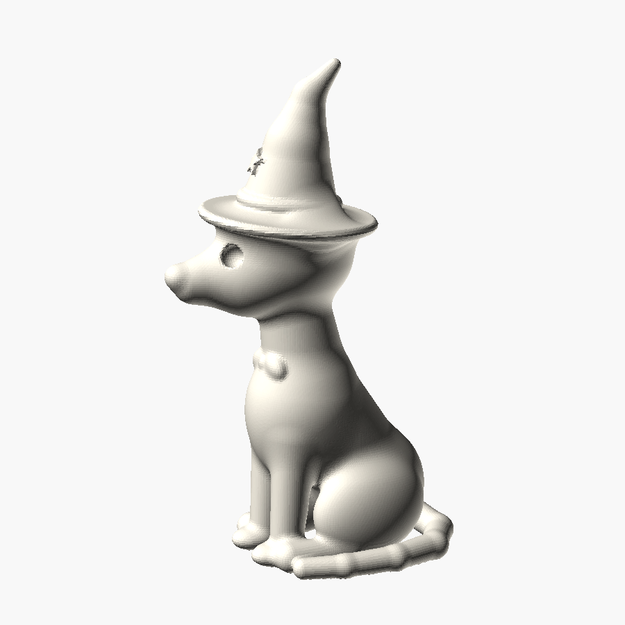 | 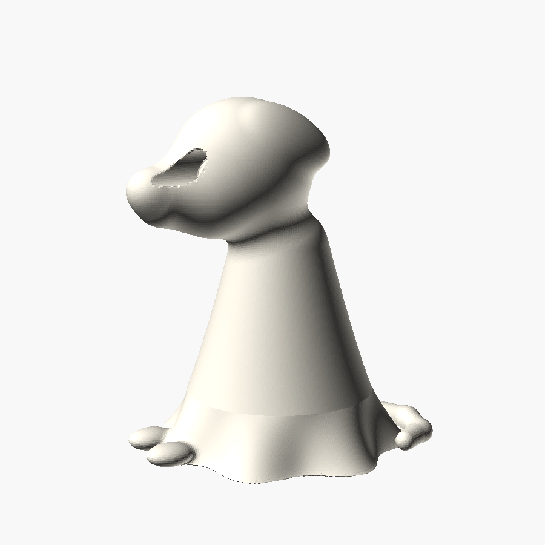 | 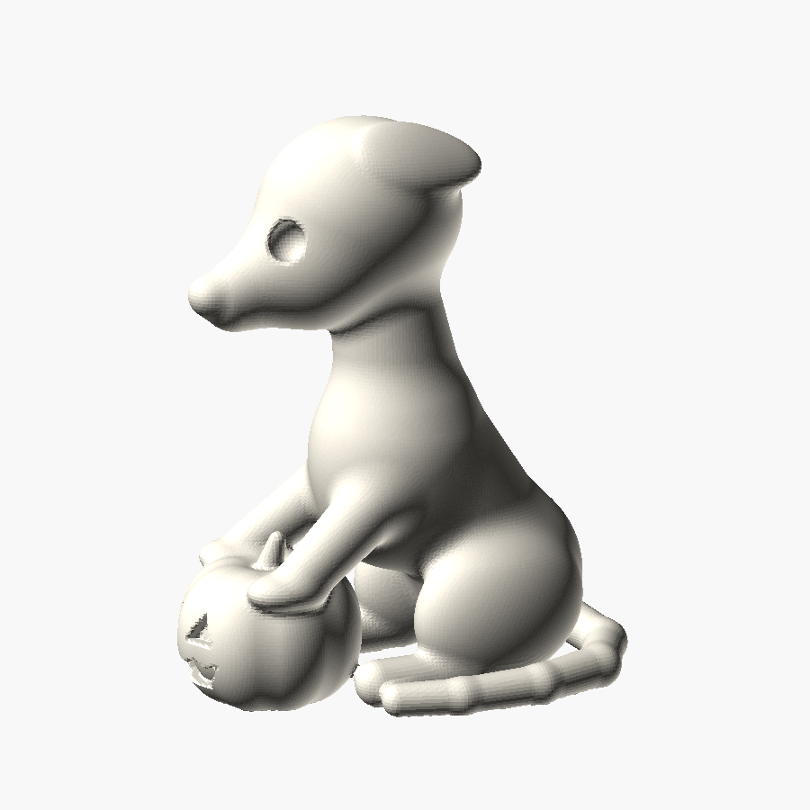 |
| 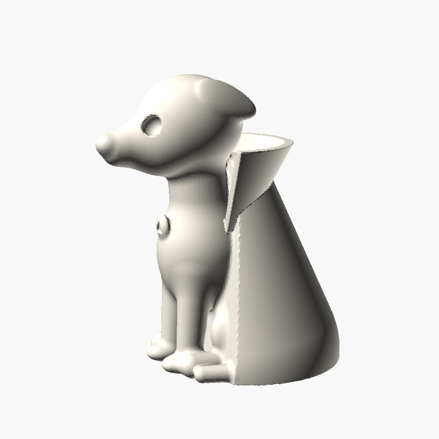 | 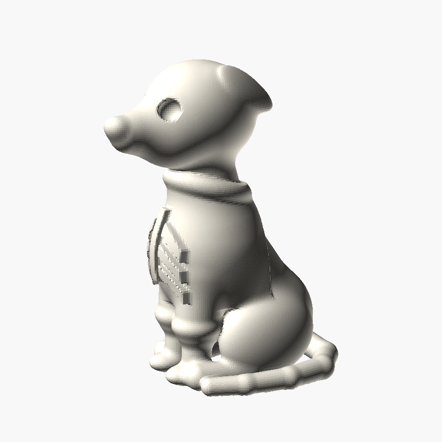 | 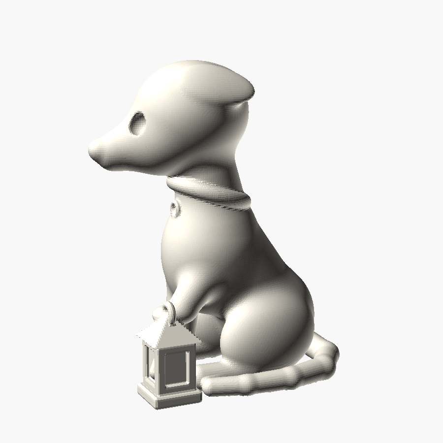 |

## Co czyni je whippetami

- długi, wąski pysk z wyraźnym noskiem;
- uszy różyczkowe, złożone do tyłu przy czaszce;
- głęboka klatka piersiowa, wcięta talia, długie cienkie przednie łapy;
- długi, cienki ogon owinięty wokół łap (u duszka wystaje spod
  prześcieradła);
- sweter i szeroka obroża, czyli typowa garderoba charta.

## Druk

- **Bez podpór.** Każda figurka stoi na płaskim spodzie. Brak „wysp”
  (fragmentów zaczynających się w powietrzu) sprawdziłem skryptem na siatce.
  Zostają drobne nawisy pod brodą, pod łapami opartymi na dyni i
  latarence oraz pod rondem kapelusza (spód ronda to lejek ok. 55°).
  Z wentylatorem na 100% drukują się czysto.
- Warstwa **0,12 mm** (0,08 mm, jeśli chcesz ostrzejsze oczy i buźkę
  dyni), dysza 0,4 mm, 2–3 obwody, wypełnienie 10–15%.
- **Waga:** pełna objętość to 2,7–4,7 cm³ (najwięcej mają duszek i wampir),
  więc przy 2 obwodach i 15% wypełnienia wychodzi ok. 2–3,5 g PLA na
  figurkę.
- Kołnierz wampira ma ok. 0,95 mm grubości. Przy dyszy 0,4 mm to 2
  obwody. Jeśli skalujesz figurki w dół, nie schodź poniżej ok. 90%.
- Pomaluj je albo wydrukuj w kolorze: dynia pomarańczowa, duszek biały
  (świeci w ciemności).

## Zmiany i generowanie

Modele są parametryczne i generuje je skrypt
[`whippets.py`](whippets.py). Figurki składają się z pól odległości (SDF):
elipsoid, kul i zaokrąglonych stożków łączonych gładko (smooth union).
Dzięki temu powierzchnia jest miękka jak u odlewanych figurek. Siatkę
tworzy marching cubes.

```bash
pip install numpy scikit-image trimesh fast-simplification
python3 whippets.py                    # wszystkie 6 do stl/, skala 1.25 (ok. 31 mm)
python3 whippets.py ghost pumpkin      # tylko wybrane
python3 whippets.py --scale 1.6        # większe, ok. 40 mm
python3 whippets.py --voxel 0.25       # szybki podgląd (gorsza jakość)
```

Nazwy modeli: `witch`, `ghost`, `pumpkin`, `vampire`, `skeleton`, `lantern`.
Pozę psa ustawia klasa `Dog`: obrót głowy (`head_rot`), położenie przednich
łap (`front_legs`) i typ uszu (`ears`). Każde przebranie to osobna funkcja,
więc nowe łatwo dopisać.
