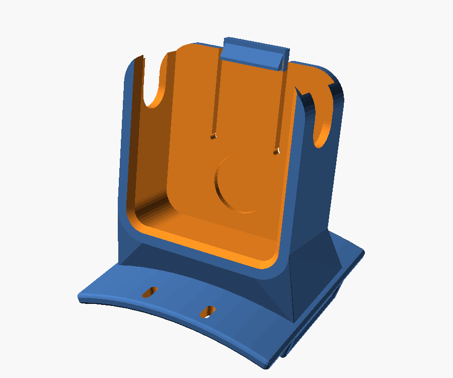
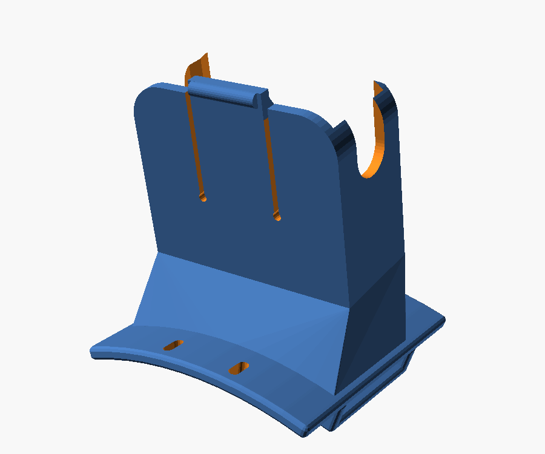
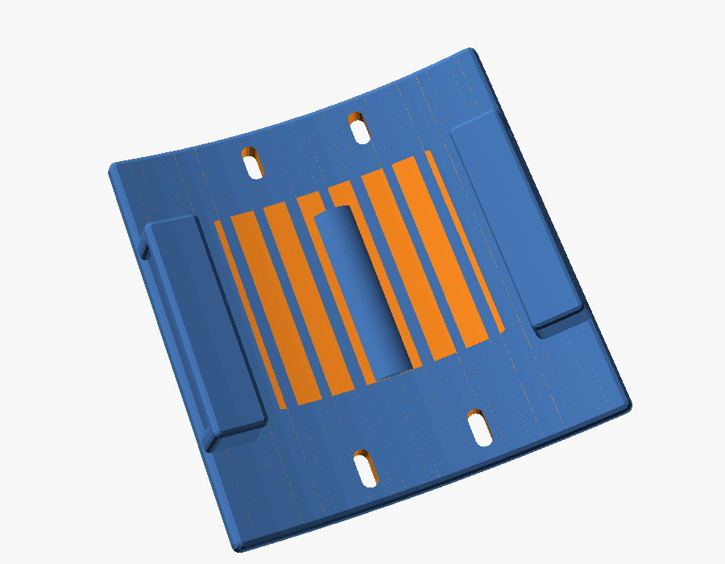
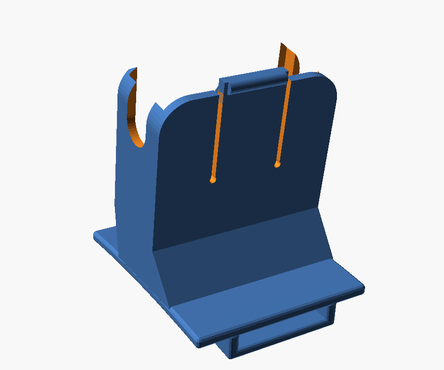
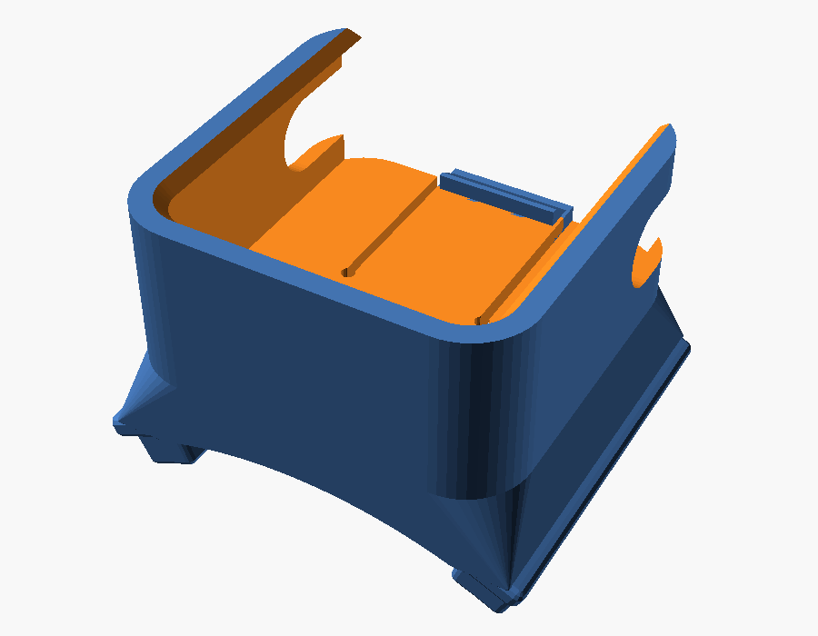

# Uchwyt Insta360 GO Ultra dla psa (whippet Bianka)

Parametryczny model OpenSCAD do druku 3D. Uchwyt nasuwa się na taśmę szelek
albo obroży, a kamerę wsuwa się od góry, aż zatrzaśnie się na sprężystym
języczku.

| Szelki, pas w poprzek grzbietu (przód / tył) | | Spód: tunele i garb |
|---|---|---|
|  |  |  |

| Szelki typu H, taśma wzdłuż kręgosłupa | Obroża |
|---|---|
|  |  |

## Dlaczego tak

- **Montaż na szelkach, nie na obroży (zalecane).** Whippet ma szyję szerszą
  od głowy, więc obroża (zwłaszcza martingale) obraca się i kamera ląduje z
  boku. Na grzbiecie, między łopatkami, kamera jest stabilna, widzi
  głowę psa i teren przed nim, a ciężar (ok. 53 g kamera + ok. 25–30 g uchwyt)
  rozkłada się na tułów. Tryb obroży jest dostępny, ale jako drugi wybór.
- **Mechaniczna blokada zamiast samego magnesu.** Whippet w sprincie osiąga
  ponad 50 km/h, a w galopie występują duże przeciążenia. Sam magnes kamery
  by tego nie utrzymał. Kamerę trzymają wargi z przodu (boki i dół), ścianki
  boczne i zaczep na sprężystym języczku od góry. Wkładasz ją od góry: skos
  zaczepu sam odgina języczek i słychać kliknięcie. Wyjmujesz, odciągając
  języczek za wałek z tyłu.
- **Stalowa podkładka** wklejona w tylną ściankę przyciąga magnes w kamerze,
  więc kamera nie grzechocze w kieszeni.
- **Tunele na taśmę z garbem pośrodku** działają jak klamra „triglide”: taśma
  biegnie pod poprzeczką, nad garbem i znów pod poprzeczką, więc pod
  naciągiem uchwyt się nie przesuwa. Nie trzeba go przykręcać ani przyklejać
  do szelek.
- **Wygięta baza** (promień ciała) przylega do grzbietu, a szerokie skrzydła
  przód/tył przeciwdziałają kiwaniu kamery. Szczeliny w skrzydłach są na
  opaskę zaciskową, rzep albo linkę asekuracyjną do szelek.
- **Bezpieczeństwo psa:** strona od ciała jest gładka i zaokrąglona, bez
  ostrych krawędzi i bez śrub.
- **Obraz:** front kamery jest otwarty, a wargi zachodzą tylko 2,2 mm i mają
  sfazowane krawędzie, żeby nie wchodziły w kadr przy 155° FOV. Kamera jest
  domyślnie pochylona o 10° w górę (`tilt`), żeby kadr nie był wypełniony
  karkiem psa.

## Zanim wydrukujesz: pomiary

1. **Taśma**, na której będzie uchwyt: szerokość (`strap_w`) i grubość
   (`strap_t`), mierzone suwmiarką bez ściskania.
2. **Kamera.** Model zakłada 46,0 × 45,7 × 18,3 mm (dane producenta) i
   promień narożników 6 mm. Zmierz swoją sztukę suwmiarką. Jeśli narożniki
   kamery są bardziej zaokrąglone niż 6 mm, nic nie trzeba zmieniać (mniejszy
   promień w modelu = więcej miejsca).
3. **Najpierw wydrukuj `stl/test_pasowania_kamery.stl`** (ok. 12 g, ok. 1 h).
   Sprawdzisz na nim, czy kamera wchodzi z lekkim oporem, zatrzaskuje się i
   nie zasłania obiektywu. W razie potrzeby zmień `clr` (luz) o ±0,1 mm
   albo `lip`, jeśli warga zachodzi na obiektyw.

## Gotowe pliki STL (`stl/`)

| Plik | Na co |
|---|---|
| `szelki_pas_poprzeczny_25mm.stl` | szelki, taśma 25 × 3,5 mm biegnąca w poprzek grzbietu (pas za łopatkami) |
| `szelki_pas_wzdluz_grzbietu_25mm.stl` | szelki typu H, taśma 25 mm wzdłuż kręgosłupa |
| `obroza_38mm.stl` | obroża 38 × 3 mm, kamera na zewnątrz |
| `test_pasowania_kamery.stl` | sama kieszeń do sprawdzenia pasowania |

Jeśli Twoja taśma ma inne wymiary, wygeneruj STL ponownie (poniżej).

## Generowanie własnego wariantu

Otwórz `go_ultra_dog_mount.scad` w OpenSCAD i ustaw parametry w panelu
Customizer (Okno → Customizer), potem F6 i eksport STL. Możesz też użyć
linii poleceń:

```sh
# szelki, taśma 20 x 3 mm w poprzek grzbietu, kamera pochylona o 15°
openscad -o moj.stl -D strap_w=20 -D strap_t=3 -D tilt=15 go_ultra_dog_mount.scad

# obroża 50 mm (typowa dla chartów)
openscad -o obroza50.stl -D 'mode="collar"' -D strap_w=50 -D strap_t=3 go_ultra_dog_mount.scad

# płaska baza: drukuje się bez podpór
openscad -o plaska.stl -D body_r=0 go_ultra_dog_mount.scad
```

Najważniejsze parametry:

| Parametr | Domyślnie | Opis |
|---|---|---|
| `mode` | `harness` | `harness`: kamera stoi na grzbiecie; `collar`: leży na obroży |
| `strap_dir` | `across` | `across`: taśma w poprzek grzbietu; `along`: wzdłuż kręgosłupa |
| `strap_w`, `strap_t` | 25, 3,5 | wymiary taśmy |
| `body_r` | -1 (auto) | promień ciała pod uchwytem: auto = 80 (grzbiet w poprzek), 400 (wzdłuż), 55 (szyja); 0 = płasko |
| `tilt` | 10 | pochylenie kamery w górę (°), tylko `harness` |
| `riser` | -1 (auto) | dodatkowe uniesienie kamery nad bazą |
| `clr` | 0,35 | luz kieszeni na stronę |
| `slit_len` | 22 | długość nacięć języczka: dłuższe = lżejszy zatrzask |
| `washer` | true | gniazdo na podkładkę M8 (16 × 1,6 mm) |

## Druk

- **Materiał: PETG** (zalecany: wytrzymały, sprężysty zatrzask, odporny na
  słońce i wilgoć). Może być też ASA. PLA odradzam: jest kruchy na
  zatrzasku i mięknie w nagrzanym aucie.
- Warstwa 0,2 mm, **4 obrysy**, 4 warstwy góra i dół, wypełnienie 25–30%
  (gyroid).
- **Orientacja: tak jak w pliku** (baza na dole). Wygięta baza i tunele
  potrzebują **podpór tylko od stołu** (najlepiej drzewiastych/organic).
  Kieszeń i zaczep drukują się bez podpór. Spód po zdjęciu podpór przeszlifuj
  papierem, bo dotyka sierści.
- Jeśli chcesz uniknąć podpór, ustaw `body_r = 0` (płaska baza). Na
  szelkach z wyściełanym panelem na grzbiecie to w zupełności wystarczy.
- Brim 5 mm poprawi przyczepność.

## Montaż

1. Wklej podkładkę stalową M8 (DIN 125, 16 × 1,6 mm) w okrągłe gniazdo w
   kieszeni (klej CA albo epoksyd). Opcjonalnie zaklej ją cienką taśmą lub
   filcem, żeby nie rysowała kamery.
2. Rozepnij klamrę szelek i przełóż taśmę: pod pierwszą poprzeczką, nad
   garbem pośrodku, pod drugą poprzeczką. Zapnij i dociągnij szelki jak
   zwykle.
3. Uchwyt powinien leżeć na środku grzbietu, między łopatkami lub tuż za
   nimi, kieszenią do przodu (front kamery w stronę głowy psa).
4. Opcjonalnie przewlecz opaskę zaciskową albo cienki rzep przez parę
   szczelin w skrzydle i przypnij do panelu szelek. To dodatkowa blokada
   przed obracaniem się uchwytu i linka asekuracyjna.
5. Wsuń kamerę od góry, frontem (obiektywem) do przodu, aż kliknie zaczep.

## Wskazówki do nagrywania z Bianką

- Pierwsze próby rób na spacerze, nie od razu w sprincie na wybiegu.
  Sprawdź, czy uchwyt nie obciera i czy Bianka go akceptuje.
- Włącz stabilizację FlowState i horizon lock. W trybie obroży ustaw obrót
  obrazu w aplikacji (kamera leży „bokiem”).
- GO Ultra mocno się nagrzewa przy długim nagrywaniu 4K. Boczne wycięcia i
  otwarty front pomagają, ale w upale nagrywaj krótsze klipy.
- Szelki muszą być dopasowane. Luźne szelki przekręcą się razem z kamerą
  niezależnie od uchwytu.
- Nie zostawiaj psa z uchwytem bez nadzoru (zaczepienie o krzaki lub
  ogrodzenie).

## Ograniczenia

Model powstał bez fizycznej kamery w ręku: wymiary korpusu pochodzą ze
specyfikacji producenta, a promień narożników jest przyjęty bezpiecznie
mały. Dlatego zaczynaj od wydruku testowego. Jeśli obiektyw GO Ultra leży
bardzo blisko krawędzi korpusu, warga może delikatnie wchodzić w róg kadru.
Wtedy zmniejsz `lip` (np. do 1,6).
