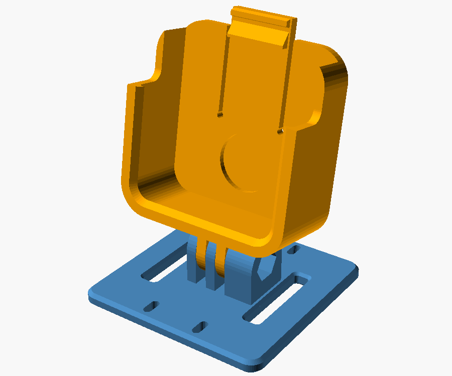
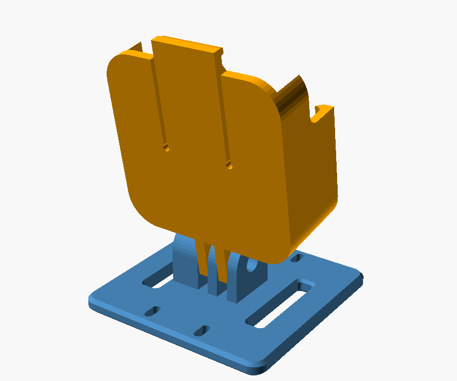
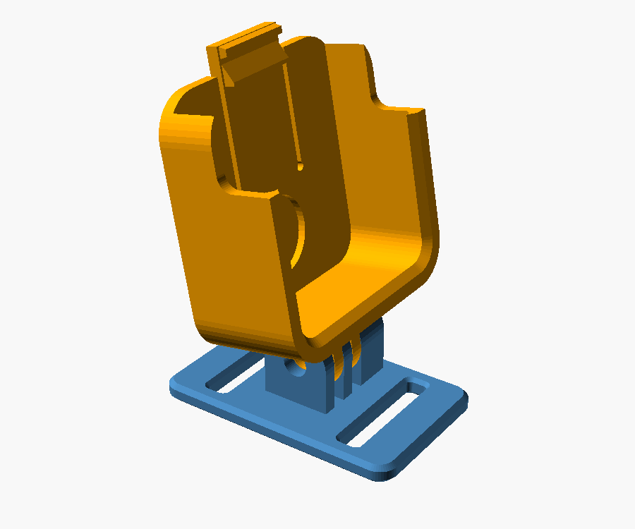
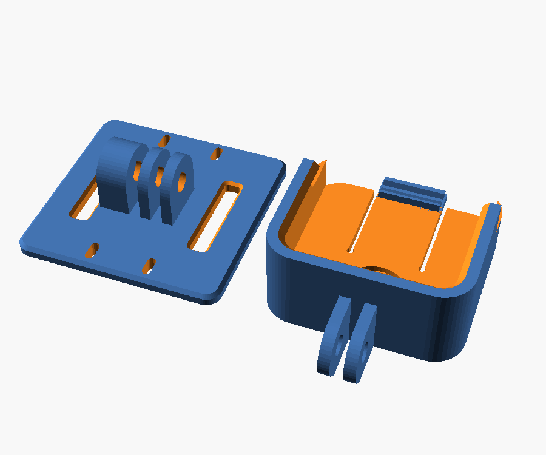
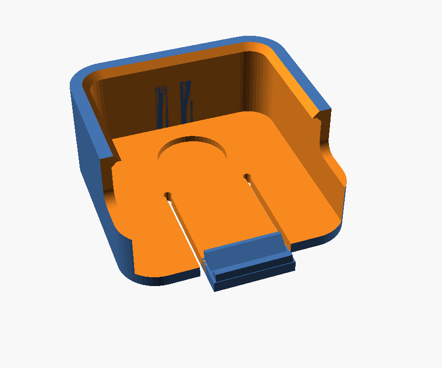
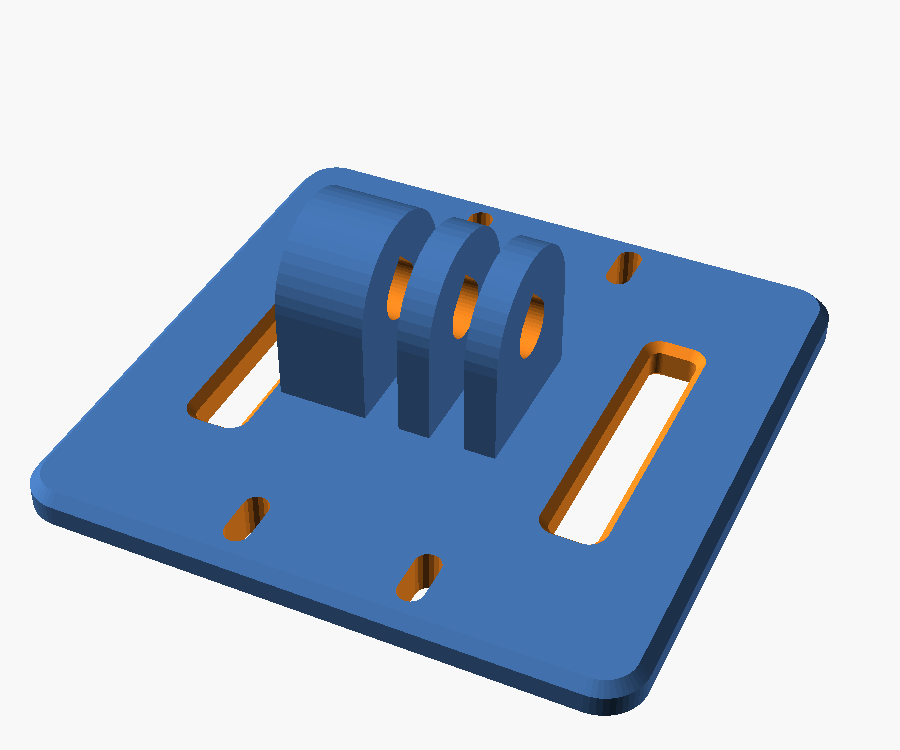

# Uchwyt Insta360 GO Ultra dla psa – v2 (druk bez podpór)

Wersja przeprojektowana pod ograniczenia druku FDM na jednodyszowej
drukarce (np. Bambu Lab P2S): **obie części drukują się bez podpór**, a
każda leży na stole dużą, płaską powierzchnią.

| Złożenie (przód) | Złożenie (tył) | Taśma wzdłuż grzbietu |
|---|---|---|
|  |  |  |

| Płyta druku (orientacja z plików STL) | Kieszeń w druku | Baza w druku |
|---|---|---|
|  |  |  |

## Co się zmieniło względem v1

| Problem w v1 | Rozwiązanie w v2 |
|---|---|
| Zakrzywiony spód bazy (łuk) wymagał podpór | **Płaski spód** z fazami 45°. Do ciała dopasowuje się taśma: jest przeplatana pod środkiem, a skrzydła dociska do grzbietu. |
| Tunele na taśmę pod płytką i garb wymagały podpór | **Dwie pionowe szczeliny**, przez które przeplatasz taśmę jak w klamrze plecaka (góra skrzydła → w dół → pod środkiem → w górę). Naprzemienne prowadzenie blokuje przesuwanie. |
| Kamera i baza w jednej bryle: zawsze któraś część „wisiała” | **Dwie części połączone złączem GoPro (śruba M5)**. Kieszeń drukujesz na plecach, a bazę spodem do stołu. |
| Wałek do odciągania języczka wystawał pod tylną ścianką | Zastąpiony **grzbietem pod kciuk** na wierzchu języczka |
| Boczne wycięcia tworzyły wiszący „daszek” | Wycięcia ścinają górę boków **od frontu**, więc w druku są otwarte do góry |
| Poziomy nawis 2,2 mm pod wargami | **Podparcie 45° pod wargą**: zostaje półka 1,0 mm, którą drukarka robi bez problemu |
| Okrągłe otwory poziome | Otwory w kształcie **kropli** (szpic w górę) i gniazdo nakrętki z płaskim sufitem (most 4,7 mm) |

Bonusy złącza GoPro:
- **Pochylenie kamery regulujesz na śrubie** (od −45° do +75° bez kolizji),
  zamiast drukować nową wersję.
- Kieszeń pasuje do każdego uchwytu GoPro (rower, kask, przyssawka), a na
  bazę możesz założyć oryginalny Quick Release Mount od GO Ultra albo
  dowolną kamerę z mocowaniem GoPro.

## Weryfikacja

Pliki STL sprawdziłem skryptem, który szuka ścianek skierowanych w dół,
nachylonych pod kątem mniejszym niż 45° od poziomu i nieleżących na
stole. Wynik:

| Część | Jedyny nawis | Ocena |
|---|---|---|
| Kieszeń | półka 1,0 mm pod wargami (za skosem 45°) | drukuje się bez podpór |
| Baza (każdy wariant) | sufit gniazda nakrętki: most 4,7 × 5 mm | drukuje się bez podpór |

Sprawdziłem też kolizje kieszeni z bazą przy pochyleniach −45°, −30°, 0°,
+30°, +45°, +60°, +75°: części nie nachodzą na siebie.

## Pliki (`stl/`, już ustawione do druku)

| Plik | Na co |
|---|---|
| `kieszen_kamery_v2.stl` | kieszeń na kamerę (wspólna dla wszystkich baz) |
| `baza_szelki_poprzecznie_25mm_v2.stl` | szelki, taśma 25 × 3,5 mm w poprzek grzbietu |
| `baza_szelki_wzdluz_25mm_v2.stl` | szelki typu H, taśma 25 mm wzdłuż kręgosłupa |
| `baza_obroza_38mm_v2.stl` | obroża 38 × 3 mm |

Kieszeń jest jednocześnie testem pasowania kamery. Wydrukuj ją najpierw
(ok. 1 h), a bazę dopiero potem.

## Druk na Bambu Lab P2S

- **Podpory: WYŁĄCZONE.**
- Filament: **PETG** (np. PETG HF), płyta Textured PEI. Jeśli masz ASA, też
  się nada. PLA odradzam: kruchy zatrzask, mięknie w nagrzanym aucie.
- Warstwa 0,2 mm, **4 ściany**, 4 warstwy góra i dół, wypełnienie 25–30%
  gyroid.
- Orientacja: tak jak w plikach (nie obracaj). Kieszeń leży tylną ścianką
  na stole, a baza spodem.
- Brim niepotrzebny. Przy PETG warto obniżyć wentylator do ok. 40–60% dla
  lepszej przyczepności warstw w palcach złącza.
- Obie części mieszczą się razem na jednym stole (`part = "print_plate"`).

## Potrzebne elementy

- Śruba **M5 × 20–25 mm** (imbus lub z łbem grzybkowym) + **nakrętka M5**
  (najlepiej samokontrująca nyloc). Gniazdo nakrętki jest w pogrubionym
  palcu bazy. Zamiennie możesz użyć śruby radełkowanej GoPro.
- Podkładka stalowa **M8 DIN 125 (16 × 1,6 mm)** + klej CA lub epoksyd
  (opcjonalnie, dociąga kamerę magnesem i kasuje luzy).
- Opcjonalnie opaska zaciskowa lub cienki rzep do szczelin w skrzydłach.

## Montaż

1. Wklej podkładkę w okrągłe gniazdo w kieszeni.
2. Wciśnij nakrętkę w sześciokątne gniazdo bazy.
3. Przeplecz taśmę szelek przez bazę: od zewnątrz po wierzchu skrzydła, w
   dół przez szczelinę, pod środkiem bazy (między bazą a psem), w górę
   przez drugą szczelinę i dalej po wierzchu drugiego skrzydła.
4. Włóż 2 palce kieszeni między 3 palce bazy, przełóż śrubę i ustaw kąt.
   Na grzbiecie zacznij od ok. 10° w górę. Dokręć tak, żeby kieszeń nie
   dała się przekręcić palcami.
5. Wsuń kamerę od góry, obiektywem do przodu, aż kliknie zaczep. Żeby ją
   wyjąć, pchnij grzbiet języczka kciukiem do tyłu i wysuń kamerę za boki
   w miejscu wycięć.

Baza na szelkach powinna leżeć na środku grzbietu, między łopatkami lub
tuż za nimi. Złącze GoPro ustaw tak, żeby kamera patrzyła w stronę głowy
psa.

## Parametry (OpenSCAD → Okno → Customizer)

| Parametr | Domyślnie | Opis |
|---|---|---|
| `part` | `assembly` | `cradle` / `base` / `assembly` / `print_plate` |
| `strap_dir` | `across` | `across`: taśma w poprzek grzbietu lub obroża; `along`: wzdłuż kręgosłupa |
| `preset` | `harness` | `harness`: długie skrzydła; `collar`: krótka baza na obrożę |
| `strap_w`, `strap_t` | 25, 3,5 | wymiary taśmy (zmierz suwmiarką) |
| `clr` | 0,35 | luz kieszeni na stronę |
| `cam_r` | 6 | promień narożników kamery (mniejszy = bezpieczniej) |
| `lip_gusset` | 1,2 | skos pod wargą (większy = mniejszy nawis, ale może dotknąć krawędzi kamery) |
| `wing`, `base_ly` | auto | długość skrzydeł i szerokość bazy |
| `tilt` | 10 | kąt kamery na podglądzie (`assembly`) |

Przykłady z linii poleceń:

```sh
# kieszeń
openscad -o kieszen.stl -D 'part="cradle"' go_ultra_dog_mount_v2.scad
# baza na taśmę 20 x 2,5 mm
openscad -o baza.stl -D 'part="base"' -D strap_w=20 -D strap_t=2.5 go_ultra_dog_mount_v2.scad
# baza na obrożę 50 mm
openscad -o obroza.stl -D 'part="base"' -D 'preset="collar"' -D strap_w=50 -D strap_t=3 go_ultra_dog_mount_v2.scad
```

## Ograniczenia

- Wymiary kamery pochodzą ze specyfikacji producenta (46 × 45,7 × 18,3 mm),
  a promień narożników jest przyjęty z zapasem. Dlatego zacznij od wydruku
  kieszeni.
- Kamera stoi wyżej niż w v1 (o ok. 15 mm), bo tyle miejsca potrzebuje
  obrotowe złącze GoPro.
- Baza jest płaska. Na szelkach z wyściełanym panelem na grzbiecie
  przylega dobrze. Bez wyściółki zostaw szelki odrobinę ciaśniej, żeby
  skrzydła nie odstawały.
