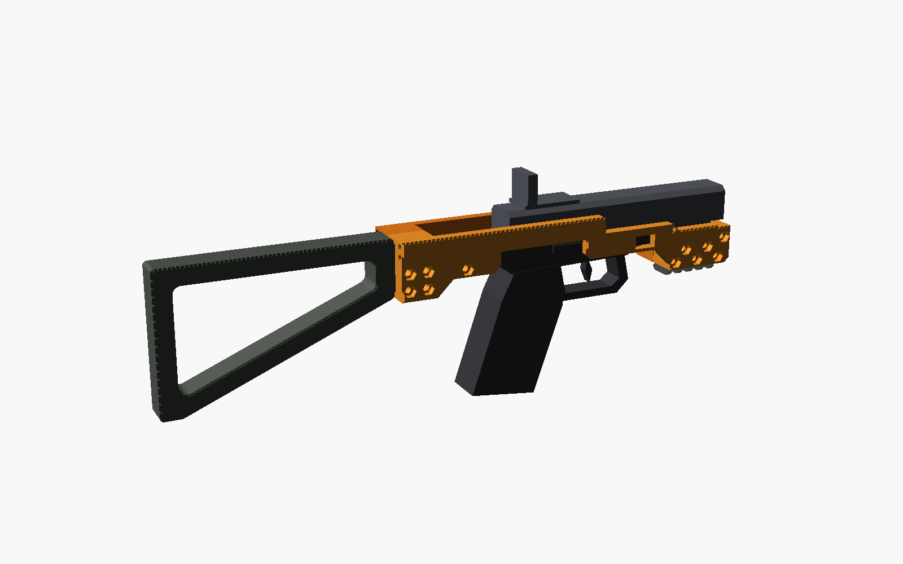
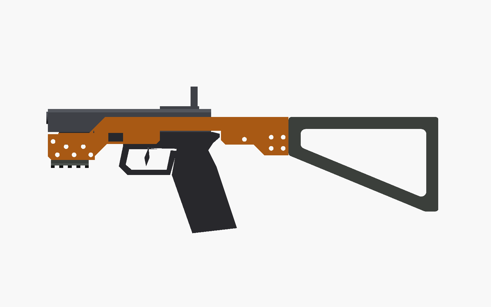
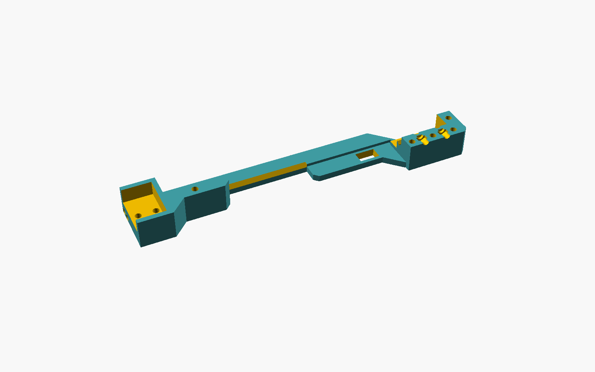
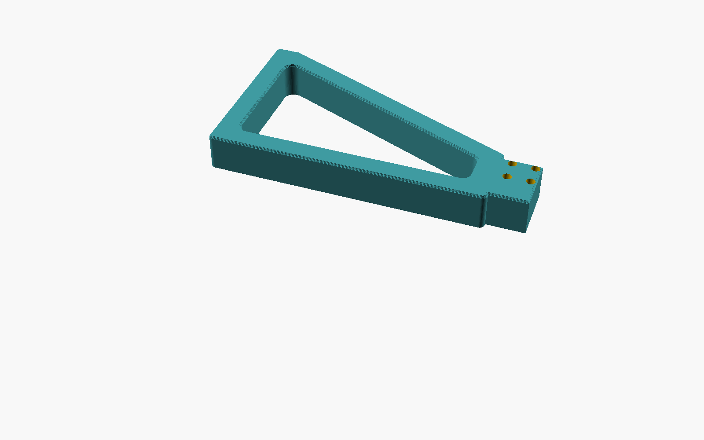
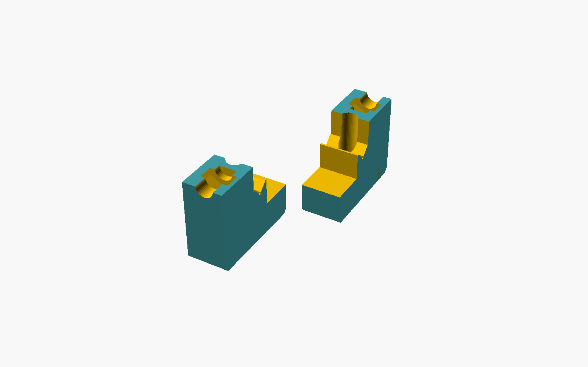

# Chassis PCC do Walther PDP Full Size 4,5" (v1)

Drukowana konwersja pistoletu na karabinek: chassis zaciskane na szynie
Picatinny pod lufą, z kolbą stałą i szyną akcesoryjną. Model parametryczny
w OpenSCAD, **wszystkie części drukują się bez podpór**.

| Lewa strona | Prawa strona (okno wyrzutowe) |
|---|---|
|  |  |

| Widok z boku | Części |
|---|---|
|  |  |

> **Stan projektu: v1, nieprzymierzona do pistoletu.** Nie miałem dostępu
> do egzemplarza ani do rysunków. Szyna Picatinny jest znormalizowana, ale
> pozostałe wymiary PDP (szerokości, położenie dźwigni, okna wyrzutowego,
> ogona szkieletu) to wartości ze specyfikacji i szacunki. Dlatego najpierw
> **zmierz pistolet, wpisz wymiary i wydrukuj sprawdziany** (niżej), a
> dopiero potem całość.

## Jak to działa

- **Dwie połówki (lewa i prawa)** skręcane śrubami M5 obejmują szynę
  Picatinny pistoletu skosami 45°. **Dwie śruby przechodzą przez rowki
  szyny** i przenoszą odrzut, tak jak w montażach latarek i w fabrycznych
  zestawach (np. Recover Tactical 20/20).
- **Zamek zostaje odkryty od góry.** Kolimator i przyrządy zostają na
  zamku, przeładowujesz za górną część zamka lub za kolimator. Przy strzale
  zamek cofa się w tunel za pistoletem (zapas 7 mm za pełnym odrzutem).
- **Prawa ścianka jest obniżona pod oknem wyrzutowym**, a za chwytem i przy
  dźwigniach zwalniacza zamka chassis ma wolną przestrzeń na dłoń i kciuk.
- **Okienka na zaczepy rozkładania** po obu stronach: zamek zdejmiesz do
  czyszczenia bez wykręcania pistoletu z chassis.
- **Kolba** ma pióro, które wchodzi między połówki i jest ściśnięte 4
  śrubami M5. Długość kolby (spust–stopka) to domyślnie 340 mm.
- **4 pręty gwintowane M5** wklejone w pasy wzdłuż zamka. Bez nich pasy
  9 × 16 mm z samego tworzywa uginałyby się pod naciskiem policzka.
- **Szyna akcesoryjna** (Picatinny, 4 rowki) przykręcana od spodu, na
  chwyt przedni, ogranicznik dłoni albo latarkę.

| Zacisk na szynie (przekrój) | Zamek w pełnym odrzucie |
|---|---|
|  |  |

## Pliki (`stl/`, już ustawione do druku)

| Plik | Co to | Wymiary na stole |
|---|---|---|
| `sprawdzian_szyny.stl` | 12 mm wycinek zacisku (obie połówki), **drukuj pierwszy** | 28 × 65 mm |
| `sprawdzian_profilu.stl` | płaski szablon boku 1,2 mm, do przyłożenia do pistoletu | 281 × 50 mm (obróć po przekątnej) |
| `chassis_lewa.stl` | lewa połówka (gniazda łbów śrub) | 231 × 216 mm (już obrócona o 45°) |
| `chassis_prawa.stl` | prawa połówka (gniazda nakrętek, okno wyrzutowe) | 231 × 216 mm |
| `kolba.stl` | kolba szkieletowa | 199 × 110 mm |
| `szyna_akcesoryjna.stl` | szyna Picatinny pod blok przedni | 44 × 21 mm |

Połówki chassis mają 280 mm długości, więc wymagają **stołu 256 × 256 mm**
(Bambu Lab P2S, X1, P1) i leżą po przekątnej. Na mniejszym stole ta wersja
się nie zmieści.

## Krok 1: zmierz pistolet

**Rozładuj pistolet, wyjmij magazynek, sprawdź komorę.** Mierz suwmiarką i
wpisz wartości w OpenSCAD (Okno → Customizer, sekcje „ZMIERZ”).
Współrzędna X liczy się od tylnej płaszczyzny zamka w stronę lufy.

| Parametr | Domyślnie | Co zmierzyć |
|---|---|---|
| `slide_len` | 190,5 | długość zamka |
| `slide_w` | 29,5 | szerokość zamka w najszerszym miejscu |
| `slide_travel` | 55 | o ile zamek cofa się do tyłu (zmierz przy zamku odciągniętym do oporu) |
| `dc_overhang` | 12,7 | o ile zamek wystaje do przodu poza szkielet |
| `frame_w` | 31 | szerokość szkieletu tuż nad szyną |
| `ctrl_w` | 34,5 | największa szerokość pistoletu (po dźwigniach zwalniacza zamka) |
| `rail_drop` | 17,5 | od dolnej krawędzi zamka do dolnej płaszczyzny szyny |
| `rail_len` | 42 | długość szyny licząc od czoła szkieletu |
| `slot_first` | 8,5 | od czoła szkieletu do środka pierwszego rowka |
| `bt_over` | 10 | o ile ogon szkieletu (beavertail) wystaje za tył zamka |
| `win_x1` | 60 | X, od którego może zaczynać się płyta boczna (przed „łopatką” dźwigni zwalniacza zamka) |
| `ej_x0`, `ej_x1` | 76, 124 | X tylnej i przedniej krawędzi okna wyrzutowego, z zapasem po 3–5 mm |
| `ej_top` | 5 | ile ścianki może zostać pod oknem wyrzutowym (dolna krawędź okna nad dolną krawędzią zamka, minus 3 mm) |
| `td_x0`, `td_x1`, `td_z0`, `td_z1` | 103, 120, −11, −1 | położenie zaczepów rozkładania |
| `trig_x` | 75 | X spustu (tylko do długości kolby) |

Sprawdź też, czy spód zamka w części wystającej przed szkielet nie schodzi
poniżej linii podziału zamek/szkielet. Jeśli schodzi, zwiększ `floor_gap`.

## Krok 2: sprawdziany

1. **`sprawdzian_szyny`** (ok. 30 min): dwie „szczęki” z jednym otworem.
   Załóż je na szynę pistoletu tak, żeby otwór trafił w rowek, przełóż
   śrubę M5 i dokręć. Skosy mają przylegać, szczęki nie mogą stykać się
   pod szyną (ma zostać szczelina ok. 0,5 mm) ani opierać o szkielet nad
   szyną. Za luźno: zmniejsz `rail_clr`. Nie wchodzi: zwiększ `rail_clr`
   albo `frame_clr`.
2. **`sprawdzian_profilu`** (ok. 20 min): przyłóż do prawego boku
   pistoletu, otwory śrub ryglujących na rowkach szyny. Sprawdź, czy
   wycięcie trafia w okno wyrzutowe, okienko w zaczep rozkładania, płyta
   nie zasłania dźwigni, a tylny koniec zostawia ok. 1,5 mm za ogonem
   szkieletu. Popraw parametry i wygeneruj STL ponownie.

## Druk

| Połówka chassis na stole | Kolba | Sprawdzian szyny |
|---|---|---|
|  |  |  |

- **Podpory: WYŁĄCZONE.** Części leżą na stole płaską stroną zewnętrzną, a
  wszystkie gniazda są otwarte do góry.
- **Materiał:** połówki chassis najlepiej **PA-CF, PA12-CF lub PET-CF**
  (sztywność, temperatura). **PETG lub ASA** też zadziała, ale chassis
  będzie wyraźnie bardziej elastyczne. **PLA nie**: pełza pod dociskiem
  śrub, mięknie w nagrzanym aucie i pęka krucho.
- Warstwa 0,2 mm, **6 ścian**, 5 warstw góra i dół, wypełnienie **40–50%
  gyroid** (blok zacisku i gniazdo kolby wyjdą prawie pełne). Kolba: 4
  ściany, 25%.
- Gniazda łbów i nakrętek są od strony stołu. Nad nimi model ma gotowe
  **mostki** (warstwa ze szczeliną, potem z kwadratem), więc drukarka nie
  kładzie okręgów w powietrzu. Jeśli drukujesz warstwą inną niż 0,2 mm,
  ustaw parametr `layer`.
- Kanały prętów (Ø 5,6 mm) to poziome otwory. Po druku przejedź je
  wiertłem 5,5 mm.
- Brim 5 mm na końcach połówek pomaga przy nylonie. Filament z włóknem
  wymaga hartowanej dyszy.

## Potrzebne elementy

| Ilość | Element | Do czego |
|---|---|---|
| 11 | śruba imbusowa **M5 × 45** (DIN 912) | skręcenie połówek: 2 ryglujące w rowkach szyny, 4 zacisku, 1 w podłodze tunelu, 4 kolby |
| 11 | nakrętka **M5 samokontrująca** (nyloc) | jw. |
| 2 | śruba imbusowa **M5 × 12** + zwykła nakrętka M5 | szyna akcesoryjna |
| 4 | **pręt gwintowany M5 × 160 mm** (z pręta 1 m) | zbrojenie pasów |
| — | żywica epoksydowa dwuskładnikowa | wklejenie prętów |
| — | guma samoprzylepna 1–2 mm | podkładka między ogonem szkieletu a oporą |

## Montaż

1. **Pręty:** wstrzyknij żywicę w cztery kanały od tyłu połówek i wkręć
   pręty do oporu (kanał kończy się przed oknem wyrzutowym). Mają być
   zlicowane z tylną ścianą. Zostaw do utwardzenia.
2. **Szyna akcesoryjna:** włóż dwie nakrętki M5 w gniazda na płaszczyźnie
   podziału jednej z połówek (pod blokiem przednim).
3. **Rozładowany** pistolet połóż w lewej połówce, szyna w skosach.
   Sprawdź, czy otwory ryglujące wypadają w rowkach szyny.
4. Nałóż prawą połówkę, włóż pióro kolby w gniazdo z tyłu i przełóż
   wszystkie śruby M5 × 45 (łby z lewej, nakrętki z prawej).
5. Dokręcaj **najpierw dwie śruby ryglujące i cztery śruby zacisku**
   (na krzyż, z wyczuciem, ok. 2–3 Nm), potem podłogę tunelu i kolbę.
   Pod szyną ma zostać widoczna szczelina między połówkami.
6. Przykręć szynę akcesoryjną od spodu śrubami M5 × 12.
7. Podklej oporę za ogonem szkieletu gumą tak, żeby lekko dotykała ogona.

## Kontrola przed strzelaniem

Wszystko na **rozładowanej** broni:

- Zamek przesuwa się ręką na całej drodze **bez ocierania** o pasy, podłogę
  tunelu i nos chassis. Zatrzymuje się na zwalniaczu i wraca po zwolnieniu.
- Spust, zwalniacz zamka, zatrzask magazynka i zaczepy rozkładania
  działają, magazynek wypada swobodnie.
- Nic nie zasłania okna wyrzutowego (sprawdź wyrzut nabojami szkolnymi).
- Pistolet nie rusza się w chassis przy szarpaniu za kolbę.

Na strzelnicy zacznij od pojedynczych nabojów ładowanych po jednym, po
każdym strzale sprawdź śruby i wydruk. Po pierwszych 50 strzałach dokręć
śruby. Pęknięcie warstw gdziekolwiek przy zacisku lub gnieździe kolby
oznacza koniec używania tej części.

**Twarz trzymaj za blokiem tylnym.** Zamek cofa się 55 mm za pistolet, do
wnętrza tunelu, a jego górna część wystaje ponad ścianki.

## Weryfikacja modelu

Sprawdziłem skryptami (na makiecie pistoletu z tych samych parametrów):

- **Kolizje:** chassis i kolba nie przecinają się z makietą pistoletu ani
  przy zamku z przodu, ani w pełnym odrzucie. Pióro kolby nie przecina się
  z gniazdem.
- **Druk bez podpór:** jedyne powierzchnie skierowane w dół poza stołem to
  schodkowa fazka krawędzi (stopnie 0,3 mm), mostki nad gniazdami śrub
  (do 9,6 mm) i sklepienia kanałów prętów (Ø 5,6 mm).
- **Stół:** połówki zajmują 231 × 216 mm po obrocie o 45°.
- Wszystkie STL są zamkniętymi bryłami.

Makieta jest uproszczona, więc ten test potwierdza spójność modelu z
parametrami, a nie dopasowanie do prawdziwego pistoletu. Od tego są
sprawdziany.

## Parametry (OpenSCAD → Okno → Customizer)

Poza wymiarami pistoletu z kroku 1:

| Parametr | Domyślnie | Opis |
|---|---|---|
| `part` | `assembly` | `assembly` / `chassis_L` / `chassis_R` / `stock` / `acc_rail` / `rail_gauge` / `profile_gauge` |
| `slide_pos`, `explode` | 0, 0 | podgląd: położenie zamka, rozsunięcie części |
| `print_rot` | 45 | obrót połówek na stole |
| `tun_clr` | 1,75 | luz zamka w tunelu na stronę |
| `rail_clr` | 0,15 | luz na skosach szyny |
| `clamp_gap` | 0,5 | szczelina między połówkami pod szyną |
| `bt_gap` | 1,5 | luz za ogonem szkieletu (pod gumę) |
| `lock_slots` | [0, 2] | rowki, przez które idą śruby ryglujące |
| `lop` | 340 | długość kolby spust–stopka |
| `stock_t`, `butt_h` | 24, 110 | grubość kolby i wysokość stopki |
| `rod_d` | 5 | średnica prętów zbrojących |
| `layer` | 0,2 | wysokość warstwy (mostki nad gniazdami) |

```sh
# sprawdzian szyny po zmianie wymiarów
openscad -o sprawdzian.stl -D 'part="rail_gauge"' -D rail_drop=18.2 pdp_pcc_chassis.scad
# lewa połówka z krótszą kolbą i szerszym zamkiem
openscad -o lewa.stl -D 'part="chassis_L"' -D slide_w=30 pdp_pcc_chassis.scad
openscad -o kolba.stl -D 'part="stock"' -D lop=320 pdp_pcc_chassis.scad
```

## Ograniczenia v1

- Wymiary PDP nie pochodzą z pomiaru (patrz góra). Położenia okien są
  najmniej pewne.
- Pistolet jest przykręcony 11 śrubami, nie ma szybkiego zatrzasku.
- Kolba jest stała, wąska (24 mm) i bez regulacji. Nie ma składania ani
  poduszki policzkowej.
- Nie ma górnej szyny ani rączki przeładowania. Dolne 2/3 tylnych nacięć
  zamka zasłaniają pasy.
- Tylna opora tylko dotyka ogona szkieletu przez gumę. Pistolet trzyma
  się w chassis na szynie.
- Wersja tylko na stół 256 mm.

## Prawo

Dołożenie kolby do pistoletu jest w różnych krajach różnie traktowane (w
USA taki zestaw to SBR podlegający rejestracji NFA, a pionowy chwyt
przedni na pistolecie to osobna kategoria). Sprawdź przepisy u siebie i
regulamin strzelnicy, zanim to złożysz.
