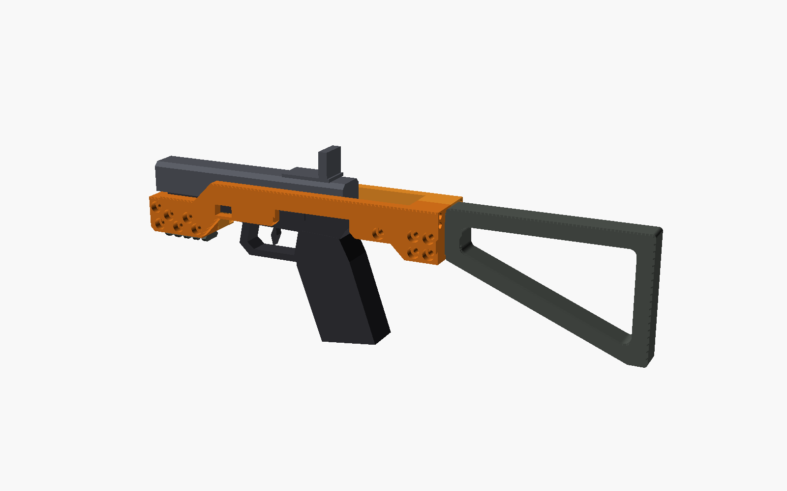
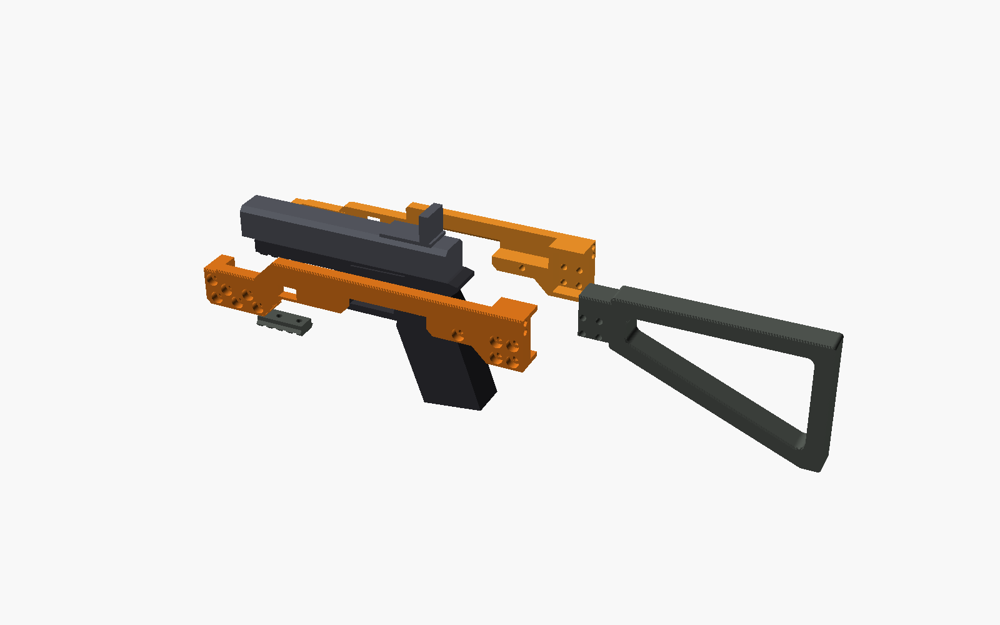
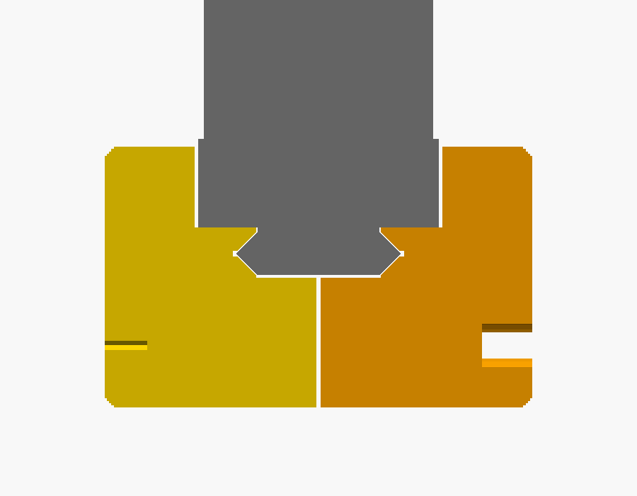
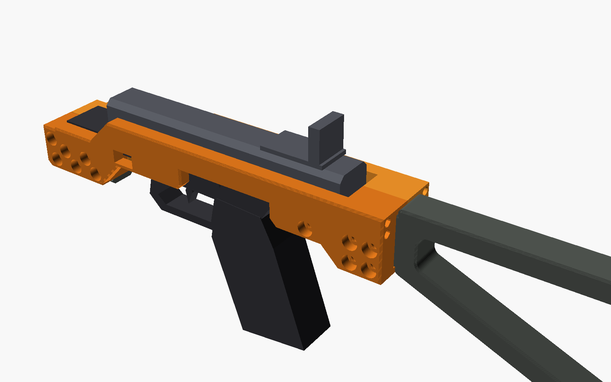

# Chassis PCC do Walther PDP Full Size 4,5" (v1.1, PETG / Bambu Lab P2S)

Drukowana konwersja pistoletu na karabinek: chassis zaciskane na szynie
Picatinny pod lufą, z kolbą stałą i szyną akcesoryjną. Model parametryczny
w OpenSCAD, **wszystkie części drukują się bez podpór**. Pliki STL w `stl/`
są przygotowane pod **PETG na Bambu Lab P2S** (stół 256 × 256 mm).

| Lewa strona | Prawa strona (okno wyrzutowe) |
|---|---|
|  |  |

| Widok z boku | Części |
|---|---|
|  |  |

> **Stan projektu: nieprzymierzony do pistoletu.** Nie miałem dostępu do
> egzemplarza ani do rysunków. Szyna Picatinny jest znormalizowana, ale
> pozostałe wymiary PDP (szerokości, położenie dźwigni, okna wyrzutowego,
> ogona szkieletu) to wartości ze specyfikacji i szacunki. Dlatego najpierw
> **wydrukuj sprawdziany (płyta 1)** i przyłóż je do pistoletu. Jeśli coś
> nie pasuje, popraw wymiary i wygeneruj STL ponownie (niżej).

## Jak to działa

- **Dwie połówki (lewa i prawa)** skręcane śrubami M5 obejmują szynę
  Picatinny pistoletu skosami 45°. **Dwie śruby przechodzą przez rowki
  szyny** i przenoszą odrzut, tak jak w montażach latarek i w fabrycznych
  zestawach (np. Recover Tactical 20/20).
- **Zamek zostaje odkryty od góry.** Kolimator i przyrządy zostają na
  zamku, przeładowujesz za górną część zamka lub za kolimator. Przy strzale
  zamek cofa się w tunel za pistoletem (zapas 7 mm za pełnym odrzutem).
- **Prawa ścianka jest obniżona pod oknem wyrzutowym**, a za chwytem i przy
  dźwigniach zwalniacza zamka chassis ma wolną przestrzeń na dłoń i kciuk.
- **Okienka na zaczepy rozkładania** po obu stronach: zamek zdejmiesz do
  czyszczenia bez wykręcania pistoletu z chassis.
- **Kolba** ma pióro, które wchodzi między połówki i jest ściśnięte 4
  śrubami M5. Długość kolby (spust–stopka) to domyślnie 340 mm.
- **4 pręty gwintowane M5** wklejone w pasy wzdłuż zamka. W PETG są
  **obowiązkowe**: pasy 11 × 16 mm z samego tworzywa uginałyby się pod
  naciskiem policzka.
- **Szyna akcesoryjna** (Picatinny, 4 rowki) przykręcana od spodu, na
  chwyt przedni, ogranicznik dłoni albo latarkę.

| Zacisk na szynie (przekrój) | Zamek w pełnym odrzucie |
|---|---|
|  |  |

## Co zmieniłem pod PETG (v1.1)

PETG jest 2–3 razy mniej sztywny niż nylon z włóknem węglowym i pełznie pod
stałym naciskiem (np. pod łbem dokręconej śruby). Dlatego:

| Zmiana | v1 | v1.1 (PETG) | Po co |
|---|---|---|---|
| Grubość pasów obok zamka (`strip_t`) | 9 mm | **11 mm** | +22% sztywności, chassis ma 55 mm szerokości |
| Gniazda łbów (`head_d` × `head_h`) | 9,4 × 5,5 | **10,6 × 6,5 mm** | mieszczą **podkładkę M5 DIN 125**: nacisk łba rozkłada się na o 65% większą powierzchnię |
| Śruby | M5 × 45 | **M5 × 50** | nakrętka nyloc łapie gwint całą wysokością |
| Wysokość bloku zacisku (`blk_h`) | 15 mm | **17 mm** | ścianka pod gniazdami łbów ≥ 2,3 mm |
| Kanały prętów | okrągłe | **kropla, szpic do góry** | PETG nie zwisa w sklepieniu, pręt wchodzi bez rozwiercania |
| Luzy: skosy szyny / szkielet / pióro kolby | 0,15 / 0,40 / 0,20 | **0,20 / 0,45 / 0,25 mm** | PETG lekko „puchnie” na krawędziach |
| Otwór M5 / gniazdo nakrętki | 5,4 / 8,3 | **5,5 / 8,4 mm** | jw. |
| Szablon profilu | prosty (282 mm) | **obrócony o 45°** | mieści się na stole P2S bez obracania w slicerze |

Przy okazji poprawiłem dwie rzeczy, które były też w v1: gniazdo przedniej
śruby zacisku przecinało skośną krawędź płyty, a na styku pasa z blokiem
przednim była szczelina 1 × 2,4 mm na wylot.

## Pliki (`stl/`, ustawione do druku, nie obracaj)

| Plik | Co to | Na stole | PETG* |
|---|---|---|---|
| `sprawdzian_szyny.stl` | 12 mm wycinek zacisku (obie połówki) | 28 × 69 mm | 16 g |
| `sprawdzian_profilu.stl` | płaski szablon prawego boku 1,2 mm | 217 × 234 mm (po przekątnej) | 11 g |
| `chassis_lewa.stl` | lewa połówka (gniazda łbów + podkładek) | 234 × 217 mm (po przekątnej) | 110 g |
| `chassis_prawa.stl` | prawa połówka (gniazda nakrętek, okno wyrzutowe) | 234 × 217 mm (po przekątnej) | 105 g |
| `kolba.stl` | kolba szkieletowa | 199 × 110 mm | 103 g |
| `szyna_akcesoryjna.stl` | szyna Picatinny pod blok przedni | 44 × 21 mm | 6 g |

\* Policzone w slicerze (PrusaSlicer, ustawienia jak niżej). Razem ok.
**350 g PETG**, czyli wystarczy jedna szpula 1 kg z dużym zapasem.

Połówki chassis mają 282 mm długości i leżą **po przekątnej stołu**, już
obrócone w pliku. Bambu Studio zachowa ten obrót, tylko wyśrodkuje część.

## Druk na Bambu Lab P2S w PETG

### Płyty

| Płyta | Co | Uwagi |
|---|---|---|
| 1 | `sprawdzian_szyny` + `sprawdzian_profilu` | **zawsze najpierw**; razem ok. 1,5 h |
| 2 | `chassis_lewa` | sama, po przekątnej |
| 3 | `chassis_prawa` | sama, po przekątnej |
| 4 | `kolba` + `szyna_akcesoryjna` | kolba: 4 ściany i 25% wypełnienia |

Na płycie 1 szablon profilu leży po przekątnej, a sprawdzian szyny zmieści
się w wolnym rogu (Arrange w Bambu Studio robi to sam).

### Ustawienia Bambu Studio

| Gdzie | Ustawienie | Wartość |
|---|---|---|
| Printer | | Bambu Lab P2S 0.4 nozzle |
| Plate type | | **Textured PEI Plate** (na gładkiej PEI daj klej w sztyfcie jako separator, PETG potrafi wyrwać kawałek powłoki) |
| Filament | | Bambu PETG HF (albo PETG Basic / Generic PETG), domyślny profil |
| Process | preset | 0.20mm Standard @BBL P2S |
| Quality | Layer height | **0,20 mm** (pod tę wysokość są zaprojektowane mostki nad gniazdami) |
| Strength | Wall loops | **6** (kolba: 4) |
| Strength | Top / Bottom shell layers | **5 / 5** |
| Strength | Sparse infill density | **40%** (kolba: 25%) |
| Strength | Sparse infill pattern | **Gyroid** |
| Support | Enable support | **wyłączone** |
| Others | Brim type | No-brim albo Auto |

Ustawienia dla kolby zmień tylko dla niej: prawy przycisk na obiekcie →
dodaj ustawienia (Wall loops, Sparse infill density).

Przy 6 ścianach pasy obok zamka i bloki wychodzą prawie pełne, a to one
pracują. Większe wypełnienie dodaje głównie masę.

### Wskazówki do PETG

- **Wysusz filament** (65 °C, 6–8 h w suszarce lub w AMS 2 Pro / AMS HT,
  jeśli masz). Wilgotny PETG ciągnie nitki i ma słabsze połączenia warstw.
- Przed pierwszym wydrukiem przetrzyj płytę IPA. Nie dotykaj jej palcami.
- Po druku odczekaj, aż stół wystygnie, zanim zdejmiesz długie połówki.
  Wygięcie płyty na ciepło może je skrzywić.
- Kanały prętów nie potrzebują rozwiercania. Jeśli pręt nie wchodzi, przejedź
  kanał wiertłem 5,5 mm.
- Jeśli drukujesz inną wysokością warstwy niż 0,2 mm, ustaw parametr `layer`
  i wygeneruj STL ponownie. Mostki nad gniazdami są liczone na warstwę.

### Sprawdziłem w slicerze

Wszystkie pliki pocięte w PrusaSlicer 2.7 na stole 256 × 256 mm z
ustawieniami jak wyżej: mieszczą się, tną się bez błędów i bez ostrzeżeń
o wiszących fragmentach. Dokładny czas pokaże Bambu Studio. PrusaSlicer
z prędkościami zbliżonymi do P2S liczył ok. 6 h na każdą połówkę, 4 h na
kolbę i 1,5 h na sprawdziany, czyli łącznie ok. 18 h. Na P2S będzie
raczej krócej.

## Krok 1: zmierz pistolet (jeśli sprawdziany nie pasują)

**Rozładuj pistolet, wyjmij magazynek, sprawdź komorę.** Mierz suwmiarką i
wpisz wartości w OpenSCAD (Okno → Customizer, sekcje „ZMIERZ”).
Współrzędna X liczy się od tylnej płaszczyzny zamka w stronę lufy.

| Parametr | Domyślnie | Co zmierzyć |
|---|---|---|
| `slide_len` | 190,5 | długość zamka |
| `slide_w` | 29,5 | szerokość zamka w najszerszym miejscu |
| `slide_travel` | 55 | o ile zamek cofa się do tyłu (zmierz przy zamku odciągniętym do oporu) |
| `dc_overhang` | 12,7 | o ile zamek wystaje do przodu poza szkielet |
| `frame_w` | 31 | szerokość szkieletu tuż nad szyną |
| `ctrl_w` | 34,5 | największa szerokość pistoletu (po dźwigniach zwalniacza zamka) |
| `rail_drop` | 17,5 | od dolnej krawędzi zamka do dolnej płaszczyzny szyny |
| `rail_len` | 42 | długość szyny licząc od czoła szkieletu |
| `slot_first` | 8,5 | od czoła szkieletu do środka pierwszego rowka |
| `bt_over` | 10 | o ile ogon szkieletu (beavertail) wystaje za tył zamka |
| `win_x1` | 60 | X, od którego może zaczynać się płyta boczna (przed „łopatką” dźwigni zwalniacza zamka) |
| `ej_x0`, `ej_x1` | 76, 124 | X tylnej i przedniej krawędzi okna wyrzutowego, z zapasem po 3–5 mm |
| `ej_top` | 5 | ile ścianki może zostać pod oknem wyrzutowym (dolna krawędź okna nad dolną krawędzią zamka, minus 3 mm) |
| `td_x0`, `td_x1`, `td_z0`, `td_z1` | 103, 120, −11, −1 | położenie zaczepów rozkładania |
| `trig_x` | 75 | X spustu (tylko do długości kolby) |

Sprawdź też, czy spód zamka w części wystającej przed szkielet nie schodzi
poniżej linii podziału zamek/szkielet. Jeśli schodzi, zwiększ `floor_gap`.

## Krok 2: sprawdziany (płyta 1)

1. **`sprawdzian_szyny`**: dwie „szczęki” z jednym otworem. Załóż je na
   szynę pistoletu tak, żeby otwór trafił w rowek, przełóż śrubę M5 z
   podkładką i dokręć. Skosy mają przylegać, szczęki nie mogą stykać się
   pod szyną (ma zostać szczelina ok. 0,5 mm) ani opierać o szkielet nad
   szyną. Za luźno: zmniejsz `rail_clr` o 0,05. Nie wchodzi: zwiększ
   `rail_clr` albo `frame_clr`. Przy okazji sprawdzisz, czy łeb z
   podkładką i nakrętka siedzą w gniazdach.
2. **`sprawdzian_profilu`**: przyłóż do prawego boku pistoletu, otwory śrub
   ryglujących na rowkach szyny. Sprawdź, czy wycięcie trafia w okno
   wyrzutowe, okienko w zaczep rozkładania, płyta nie zasłania dźwigni, a
   tylny koniec zostawia ok. 1,5 mm za ogonem szkieletu. Popraw parametry
   i wygeneruj STL ponownie.

```sh
# po poprawce wymiarów: nowe pliki do druku
openscad -o chassis_lewa.stl  -D 'part="chassis_L"' -D rail_drop=18.2 pdp_pcc_chassis.scad
openscad -o chassis_prawa.stl -D 'part="chassis_R"' -D rail_drop=18.2 pdp_pcc_chassis.scad
```

## Potrzebne elementy

| Ilość | Element | Do czego |
|---|---|---|
| 11 | śruba imbusowa **M5 × 50** (DIN 912 / ISO 4762), stal 8.8 lub nierdzewna A2 | skręcenie połówek: 2 ryglujące w rowkach szyny, 4 zacisku, 1 w podłodze tunelu, 4 kolby |
| 11 | **podkładka M5 DIN 125** (10 × 1 mm) | pod łby, w gniazdach lewej połówki |
| 11 | nakrętka **M5 samokontrująca** (nyloc, DIN 985) | w gniazdach prawej połówki |
| 2 | śruba imbusowa **M5 × 12** + zwykła nakrętka M5 | szyna akcesoryjna |
| 4 | **pręt gwintowany M5 × 160 mm** (z pręta 1 m) | zbrojenie pasów |
| — | żywica epoksydowa dwuskładnikowa (np. 5-minutowa) | wklejenie prętów |
| — | guma samoprzylepna 1–2 mm | podkładka między ogonem szkieletu a oporą |

## Montaż

1. **Pręty:** wstrzyknij żywicę w cztery kanały od tyłu połówek i wkręć
   pręty do oporu (kanał kończy się przed oknem wyrzutowym). Mają być
   zlicowane z tylną ścianą. Zostaw do pełnego utwardzenia.
2. **Szyna akcesoryjna:** włóż dwie nakrętki M5 w gniazda na płaszczyźnie
   podziału jednej z połówek (pod blokiem przednim).
3. **Rozładowany** pistolet połóż w lewej połówce, szyna w skosach.
   Sprawdź, czy otwory ryglujące wypadają w rowkach szyny.
4. Nałóż prawą połówkę, włóż pióro kolby w gniazdo z tyłu i przełóż
   wszystkie śruby M5 × 50 z podkładkami (łby z lewej, nakrętki z prawej).
5. Dokręcaj **najpierw dwie śruby ryglujące i cztery śruby zacisku** na
   krzyż, potem podłogę tunelu i kolbę. **W PETG: 1–1,5 Nm**, czyli do
   wyraźnego oporu krótkim ramieniem klucza imbusowego plus ćwierć obrotu.
   Mocniej nie: PETG pod łbem zacznie się zgniatać. Pod szyną ma zostać
   widoczna szczelina między połówkami.
6. Przykręć szynę akcesoryjną od spodu śrubami M5 × 12.
7. Podklej oporę za ogonem szkieletu gumą tak, żeby lekko dotykała ogona.
8. **Po 24 godzinach dokręć śruby jeszcze raz.** PETG osiada pod
   naciskiem, nakrętki nyloc nie odkręcą się, ale docisk spada.

## Kontrola przed strzelaniem

Wszystko na **rozładowanej** broni:

- Zamek przesuwa się ręką na całej drodze **bez ocierania** o pasy, podłogę
  tunelu i nos chassis. Zatrzymuje się na zwalniaczu i wraca po zwolnieniu.
- Spust, zwalniacz zamka, zatrzask magazynka i zaczepy rozkładania
  działają, magazynek wypada swobodnie.
- Nic nie zasłania okna wyrzutowego (sprawdź wyrzut nabojami szkolnymi).
- Pistolet nie rusza się w chassis przy szarpaniu za kolbę.

Na strzelnicy zacznij od pojedynczych nabojów ładowanych po jednym, po
każdym strzale sprawdź śruby i wydruk. Po pierwszych 50 strzałach dokręć
śruby. Pęknięcie warstw gdziekolwiek przy zacisku lub gnieździe kolby
oznacza koniec używania tej części.

**Twarz trzymaj za blokiem tylnym.** Zamek cofa się 55 mm za pistolet, do
wnętrza tunelu, a jego górna część wystaje ponad ścianki.

**Temperatura:** PETG mięknie od ok. 70–80 °C. Nie zostawiaj złożonej broni
w nagrzanym aucie ani na słońcu za szybą.

## Weryfikacja modelu

Sprawdziłem skryptami (na makiecie pistoletu z tych samych parametrów):

- **Kolizje:** chassis i kolba nie przecinają się z makietą pistoletu ani
  przy zamku z przodu, ani w pełnym odrzucie. Pióro kolby nie przecina się
  z gniazdem.
- **Druk bez podpór:** jedyne powierzchnie skierowane w dół poza stołem to
  schodkowa fazka krawędzi (stopnie 0,3 mm), mostki nad gniazdami śrub
  (do 10,6 mm) i płaskie szczyty kanałów prętów (1,1 mm).
- **Ścianki:** najcieńsza ścianka wokół gniazd śrub ma 2,2 mm (1,0 mm tylko
  w fazce pierwszych warstw).
- **Stół i slicer:** wszystkie części mieszczą się na 256 × 256 mm i tną się
  bez ostrzeżeń (PrusaSlicer 2.7).
- Wszystkie STL są zamkniętymi bryłami.

Makieta jest uproszczona, więc ten test potwierdza spójność modelu z
parametrami, a nie dopasowanie do prawdziwego pistoletu. Od tego są
sprawdziany.

## Parametry (OpenSCAD → Okno → Customizer)

Poza wymiarami pistoletu z kroku 1:

| Parametr | Domyślnie | Opis |
|---|---|---|
| `part` | `assembly` | `assembly` / `chassis_L` / `chassis_R` / `stock` / `acc_rail` / `rail_gauge` / `profile_gauge` |
| `slide_pos`, `explode` | 0, 0 | podgląd: położenie zamka, rozsunięcie części |
| `print_rot` | 45 | obrót połówek i szablonu na stole |
| `strip_t` | 11 | grubość pasów obok zamka (PA-CF: wystarczy 9) |
| `tun_clr` | 1,75 | luz zamka w tunelu na stronę |
| `rail_clr` | 0,2 | luz na skosach szyny |
| `clamp_gap` | 0,5 | szczelina między połówkami pod szyną |
| `bt_gap` | 1,5 | luz za ogonem szkieletu (pod gumę) |
| `lock_slots` | [0, 2] | rowki, przez które idą śruby ryglujące |
| `head_d`, `head_h` | 10,6, 6,5 | gniazdo łba z podkładką |
| `lop` | 340 | długość kolby spust–stopka |
| `stock_t`, `butt_h` | 24, 110 | grubość kolby i wysokość stopki |
| `rod_d` | 5 | średnica prętów zbrojących |
| `layer` | 0,2 | wysokość warstwy (mostki nad gniazdami) |

```sh
# kolba krótsza o 2 cm
openscad -o kolba.stl -D 'part="stock"' -D lop=320 pdp_pcc_chassis.scad
```

## Ograniczenia

- Wymiary PDP nie pochodzą z pomiaru (patrz góra). Położenia okien są
  najmniej pewne.
- Pistolet jest przykręcony 11 śrubami, nie ma szybkiego zatrzasku.
- Kolba jest stała, wąska (24 mm) i bez regulacji. Nie ma składania ani
  poduszki policzkowej.
- Nie ma górnej szyny ani rączki przeładowania. Dolne 2/3 tylnych nacięć
  zamka zasłaniają pasy.
- Tylna opora tylko dotyka ogona szkieletu przez gumę. Pistolet trzyma
  się w chassis na szynie.
- W PETG chassis jest wyraźnie bardziej elastyczne niż w PA-CF; przy
  mocnym docisku policzka pasy minimalnie się uginają (dlatego pręty).
- Wersja tylko na stół 256 mm.

## Prawo

Dołożenie kolby do pistoletu jest w różnych krajach różnie traktowane (w
USA taki zestaw to SBR podlegający rejestracji NFA, a pionowy chwyt
przedni na pistolecie to osobna kategoria). Sprawdź przepisy u siebie i
regulamin strzelnicy, zanim to złożysz.
